# The effect calculus: implementation plan

This plan breaks the specification in this directory into GitHub issues, ordered by dependency. The tracking issue is [#290](https://github.com/empath-nirvana/borrow-core/issues/290). Each issue names the spec ids it owns, lists the issues it depends on and the issues it blocks, and states its acceptance. Every kernel, law, metatheory, retirement, lowering and surface issue depends on SPEC-DONE ([#389](https://github.com/empath-nirvana/borrow-core/issues/389)): no kernel work starts until the specification is complete and every open question in [99-open-questions.md](99-open-questions.md) is settled or has its default confirmed. PLAN-CHECK ([#291](https://github.com/empath-nirvana/borrow-core/issues/291)) is the validation step: it checks that this issue set implements the whole calculus and not an approximation of it (01 §7, C-1 to C-12).

Issues are listed in topological order, so every issue comes after everything it depends on. The kinds are:

- **probe**: an experiment-only Lean statement or configuration. The unknowns come first: PROBE-OQ9 and PROBE-OQ58 have no dependencies, and every probe over the relation at `W` waits on both.
- **spec-resolution**: a SPEC entry (SPEC-*). Open questions are not issues: they live, boxed, in [99-open-questions.md](99-open-questions.md), and an issue that waits on one names its OQ id.
- **kernel**, **metatheory**, **law**: the calculus in `Core/`. Conditional constructs close as "not adopted" when their question keeps its default, and the R id is recorded.
- **retirement**, **lowering**, **surface**: retiring superseded code, the lowering classes with their laws, and the elaborator and acceptance programs.
- **tracking**: PLAN-CHECK, SUPERSEDE, SPEC-DONE and CALCULUS-COMPLETE.

## Issues

| key | issue | title | kind | spec ids | depends on |
|---|---|---|---|---|---|
| PLAN-CHECK | [#291](https://github.com/empath-nirvana/borrow-core/issues/291) | Validate the effect-calculus issue plan as a complete implementation plan | tracking | C-1 C-2 C-3 C-4 C-5 C-6 C-7 C-8 C-9 C-10 C-11 C-12 | — |
| SUPERSEDE | [#292](https://github.com/empath-nirvana/borrow-core/issues/292) | Fate of open effect-related issues superseded by the effect-calculus plan | tracking | — | — |
| SPEC-DOCS | [#293](https://github.com/empath-nirvana/borrow-core/issues/293) | Land the effect-calculus specification documents | spec-resolution | O-LIFE | — |
| PROBE-OQ9 | [#294](https://github.com/empath-nirvana/borrow-core/issues/294) | First probe: an open 6.64 frame at an affine stop, cancelled (OpenFrameCancel) | probe | OQ-9 | — |
| PROBE-OQ58 | [#295](https://github.com/empath-nirvana/borrow-core/issues/295) | First probe: is Core the sigma = [] instance at U (NilAgreesU) | probe | OQ-58 | — |
| PROBE-OQ1 | [#296](https://github.com/empath-nirvana/borrow-core/issues/296) | Probe OQ-1: AnsweringIsTailHandler | probe | OQ-1 | — |
| PROBE-BINARY | [#297](https://github.com/empath-nirvana/borrow-core/issues/297) | Probe OQ-4/OQ-43/OQ-47: TwoRun route, determinism up to renaming, step inclusion | probe | OQ-4 OQ-43 OQ-47 | — |
| PROBE-LAWTERMS | [#298](https://github.com/empath-nirvana/borrow-core/issues/298) | Probe OQ-27/OQ-48/OQ-49: forward-cancel term, P13.14 on the kernel, composite handler | probe | OQ-27 OQ-48 OQ-49 R-ETALIN R-INTERLIN R-FUSETAIL | — |
| PROBE-OQ24 | [#299](https://github.com/empath-nirvana/borrow-core/issues/299) | Probe OQ-24: an abortive payload that owns | probe | OQ-24 | — |
| PROBE-STATICS | [#300](https://github.com/empath-nirvana/borrow-core/issues/300) | Probe OQ-35/36/38/39: closed op types, row identity, site freshness, qualifier subsumption | probe | OQ-35 OQ-36 OQ-38 OQ-39 | — |
| PROBE-OQ37 | [#301](https://github.com/empath-nirvana/borrow-core/issues/301) | Probe OQ-37: handler carriers at every computation type | probe | OQ-37 | — |
| PROBE-OQ16 | [#302](https://github.com/empath-nirvana/borrow-core/issues/302) | Probe OQ-16: is multi-shot free | probe | OQ-16 | — |
| PROBE-OQ32 | [#303](https://github.com/empath-nirvana/borrow-core/issues/303) | Probe OQ-32: the TR's rule fixes against kernel rules | probe | OQ-32 | — |
| PROBE-OBS | [#304](https://github.com/empath-nirvana/borrow-core/issues/304) | Probe OQ-50/OQ-51: observing linear use; adequacy at a row | probe | OQ-50 OQ-51 R-ADEQF1 | — |
| PROBE-OQ8 | [#305](https://github.com/empath-nirvana/borrow-core/issues/305) | Probe OQ-8: quantifier placement over W (six clause sets) | probe | OQ-8 | PROBE-OQ9 [#294](https://github.com/empath-nirvana/borrow-core/issues/294), PROBE-OQ58 [#295](https://github.com/empath-nirvana/borrow-core/issues/295) |
| PROBE-OQ2 | [#306](https://github.com/empath-nirvana/borrow-core/issues/306) | Probe OQ-2 inputs: T1 model reading against the typing reading at every rule | probe | OQ-2 | PROBE-OQ9 [#294](https://github.com/empath-nirvana/borrow-core/issues/294), PROBE-OQ58 [#295](https://github.com/empath-nirvana/borrow-core/issues/295) |
| PROBE-OQ9B | [#307](https://github.com/empath-nirvana/borrow-core/issues/307) | Probe OQ-9 companions: OpenFrameRaise and ResumeBetweenLenders (OQ-3 configuration) | probe | OQ-9 OQ-3 | PROBE-OQ9 [#294](https://github.com/empath-nirvana/borrow-core/issues/294), PROBE-OQ58 [#295](https://github.com/empath-nirvana/borrow-core/issues/295) |
| PROBE-OQ44-54 | [#308](https://github.com/empath-nirvana/borrow-core/issues/308) | Probe OQ-44/OQ-54: a 6.65 lend open at a stop; sigma under a fork | probe | OQ-44 OQ-54 | PROBE-OQ9 [#294](https://github.com/empath-nirvana/borrow-core/issues/294), PROBE-OQ58 [#295](https://github.com/empath-nirvana/borrow-core/issues/295) |
| PROBE-OQ57 | [#309](https://github.com/empath-nirvana/borrow-core/issues/309) | Probe OQ-57: the closing-obligation index tau inside W (ClosingInW) | probe | OQ-57 | PROBE-OQ9 [#294](https://github.com/empath-nirvana/borrow-core/issues/294), PROBE-OQ58 [#295](https://github.com/empath-nirvana/borrow-core/issues/295) |
| PROBE-OQ45 | [#310](https://github.com/empath-nirvana/borrow-core/issues/310) | Probe OQ-45: the arising guard as a TW invariant (tabAt_of_TW) | probe | OQ-45 | PROBE-OQ9 [#294](https://github.com/empath-nirvana/borrow-core/issues/294), PROBE-OQ58 [#295](https://github.com/empath-nirvana/borrow-core/issues/295) |
| PROBE-FINR | [#311](https://github.com/empath-nirvana/borrow-core/issues/311) | Probe OQ-7/OQ-41/OQ-65: finalisers at a resuming TableOK table | probe | OQ-7 OQ-41 OQ-65 | PROBE-OQ9 [#294](https://github.com/empath-nirvana/borrow-core/issues/294), PROBE-OQ58 [#295](https://github.com/empath-nirvana/borrow-core/issues/295) |
| PROBE-OQ40 | [#312](https://github.com/empath-nirvana/borrow-core/issues/312) | Probe OQ-40: the borrow callback's row class (borOK_tableOK) | probe | OQ-40 | PROBE-OQ9 [#294](https://github.com/empath-nirvana/borrow-core/issues/294), PROBE-OQ58 [#295](https://github.com/empath-nirvana/borrow-core/issues/295) |
| PROBE-OQ14 | [#313](https://github.com/empath-nirvana/borrow-core/issues/313) | Probe OQ-14: a stale label meeting a reused one at W | probe | OQ-14 | PROBE-OQ9 [#294](https://github.com/empath-nirvana/borrow-core/issues/294), PROBE-OQ58 [#295](https://github.com/empath-nirvana/borrow-core/issues/295) |
| PROBE-OQ62 | [#314](https://github.com/empath-nirvana/borrow-core/issues/314) | Probe OQ-62: folds and counted loops at a row | probe | OQ-62 | PROBE-OQ9 [#294](https://github.com/empath-nirvana/borrow-core/issues/294), PROBE-OQ58 [#295](https://github.com/empath-nirvana/borrow-core/issues/295) |
| PROBE-OQ56 | [#315](https://github.com/empath-nirvana/borrow-core/issues/315) | Probe OQ-56: lifetime-polymorphic operations at a borrow callback | probe | OQ-56 | PROBE-OQ9 [#294](https://github.com/empath-nirvana/borrow-core/issues/294), PROBE-OQ58 [#295](https://github.com/empath-nirvana/borrow-core/issues/295) |
| PROBE-ASYNC | [#316](https://github.com/empath-nirvana/borrow-core/issues/316) | Probe OQ-60/OQ-61: deep scheduler carrier; self-referential signatures | probe | OQ-60 OQ-61 | PROBE-OQ9 [#294](https://github.com/empath-nirvana/borrow-core/issues/294), PROBE-OQ58 [#295](https://github.com/empath-nirvana/borrow-core/issues/295) |
| PROBE-COOP | [#317](https://github.com/empath-nirvana/borrow-core/issues/317) | Probe OQ-20/OQ-29: effectful co-operations; borrowed answers at W | probe | OQ-20 OQ-29 | PROBE-OQ9 [#294](https://github.com/empath-nirvana/borrow-core/issues/294), PROBE-OQ58 [#295](https://github.com/empath-nirvana/borrow-core/issues/295), PROBE-OQ8 [#305](https://github.com/empath-nirvana/borrow-core/issues/305) |
| PROBE-STORED | [#318](https://github.com/empath-nirvana/borrow-core/issues/318) | Probe OQ-28/OQ-46: storing a boxed continuation; the world of a stored payload | probe | OQ-28 OQ-46 | PROBE-OQ9 [#294](https://github.com/empath-nirvana/borrow-core/issues/294), PROBE-OQ58 [#295](https://github.com/empath-nirvana/borrow-core/issues/295), PROBE-OQ8 [#305](https://github.com/empath-nirvana/borrow-core/issues/305) |
| PROBE-FP-SKELETON | [#319](https://github.com/empath-nirvana/borrow-core/issues/319) | Probe: T-FP at W with every row an enumerated sorry (whole-rule-set check) | probe | T-FP T-COMPAT T-MONO | PROBE-OQ9 [#294](https://github.com/empath-nirvana/borrow-core/issues/294), PROBE-OQ58 [#295](https://github.com/empath-nirvana/borrow-core/issues/295), PROBE-OQ8 [#305](https://github.com/empath-nirvana/borrow-core/issues/305) |
| PROBE-OQ63 | [#333](https://github.com/empath-nirvana/borrow-core/issues/333) | Probe OQ-63: one ewp with a mode (EwpModeUniform), only under OQ-15 (b) | probe | OQ-63 | PROBE-OQ9 [#294](https://github.com/empath-nirvana/borrow-core/issues/294), PROBE-OQ58 [#295](https://github.com/empath-nirvana/borrow-core/issues/295), OQ-15 (open question) |
| PROBE-OQ67 | [#334](https://github.com/empath-nirvana/borrow-core/issues/334) | Probe OQ-67: a handler spanning observations of a div computation (HndLoopSpanCompat) | probe | OQ-67 R-HDIV | PROBE-OQ9 [#294](https://github.com/empath-nirvana/borrow-core/issues/294), PROBE-OQ58 [#295](https://github.com/empath-nirvana/borrow-core/issues/295), OQ-15 (open question), PROBE-STORED [#318](https://github.com/empath-nirvana/borrow-core/issues/318) |
| PROBE-OQ68 | [#346](https://github.com/empath-nirvana/borrow-core/issues/346) | Probe OQ-68: allocation as an effect (host handler model; arena configuration) | probe | OQ-68 R-ALLOCORACLE | PROBE-OQ9 [#294](https://github.com/empath-nirvana/borrow-core/issues/294), PROBE-OQ58 [#295](https://github.com/empath-nirvana/borrow-core/issues/295), OQ-30 (open question) |
| SPEC-MACHINE | [#375](https://github.com/empath-nirvana/borrow-core/issues/375) | SPEC entry for machine changes (OQ-41 (b)/(c), OQ-50 (b), OQ-52 (b)) | spec-resolution | OQ-41 OQ-50 K-STEP K-CANCEL | OQ-41 (open question), OQ-50 (open question), OQ-52 (open question) |
| SPEC-CONDITIONAL | [#376](https://github.com/empath-nirvana/borrow-core/issues/376) | SPEC entries or deltas for every adopted conditional construct | spec-resolution | K-SCOPE K-CARRIER K-BORANS K-ROWABS K-SHALLOW K-FINR K-OWNERR K-RELQ K-SWAPΣ K-SELFROW K-FOLDΣ K-GENNAME D-EWPP | OQ-3 (open question), OQ-7 (open question), OQ-12 (open question), OQ-13 (open question), OQ-14 (open question), OQ-15 (open question), OQ-17 (open question), OQ-20 (open question), OQ-24 (open question), OQ-26 (open question), OQ-29 (open question), OQ-30 (open question), OQ-35 (open question), OQ-37 (open question), OQ-38 (open question), OQ-39 (open question), OQ-56 (open question), OQ-59 (open question), OQ-61 (open question), OQ-62 (open question), OQ-63 (open question), PROBE-STATICS [#300](https://github.com/empath-nirvana/borrow-core/issues/300) |
| SPEC-E-SIG | [#377](https://github.com/empath-nirvana/borrow-core/issues/377) | SPEC entry E-SIG: one signature, rows as sums, one interpretation | spec-resolution | E-SIG | SPEC-DOCS [#293](https://github.com/empath-nirvana/borrow-core/issues/293), OQ-22 (open question), PROBE-STATICS [#300](https://github.com/empath-nirvana/borrow-core/issues/300), OQ-35 (open question), OQ-12 (open question), OQ-61 (open question), OQ-39 (open question), OQ-13 (open question), OQ-18 (open question), OQ-11 (open question), OQ-17 (open question) |
| SPEC-E-W | [#378](https://github.com/empath-nirvana/borrow-core/issues/378) | SPEC entry E-W: the world, its order, the stop, the re-indexed relation | spec-resolution | E-W | SPEC-DOCS [#293](https://github.com/empath-nirvana/borrow-core/issues/293), OQ-8 (open question), OQ-9, OQ-10 (open question), OQ-58 (open question), OQ-57 (open question), PROBE-OQ44-54 [#308](https://github.com/empath-nirvana/borrow-core/issues/308), PROBE-OQ45 [#310](https://github.com/empath-nirvana/borrow-core/issues/310), PROBE-OQ57 [#309](https://github.com/empath-nirvana/borrow-core/issues/309), PROBE-FP-SKELETON [#319](https://github.com/empath-nirvana/borrow-core/issues/319), OQ-2 (open question), OQ-3 (open question), OQ-11 (open question), PROBE-STORED [#318](https://github.com/empath-nirvana/borrow-core/issues/318) |
| SPEC-E-BOR | [#379](https://github.com/empath-nirvana/borrow-core/issues/379) | SPEC entry E-BOR: one borrow per printed constant at every TableOK row | spec-resolution | E-BOR | SPEC-E-W [#378](https://github.com/empath-nirvana/borrow-core/issues/378), PROBE-OQ40 [#312](https://github.com/empath-nirvana/borrow-core/issues/312), OQ-56 (open question), OQ-7 (open question), OQ-2 (open question) |
| SPEC-E-MODEL | [#380](https://github.com/empath-nirvana/borrow-core/issues/380) | SPEC entry E-MODEL: handlers as models; handler laws over the kernel | spec-resolution | E-MODEL | SPEC-DOCS [#293](https://github.com/empath-nirvana/borrow-core/issues/293), OQ-11 (open question), OQ-37 (open question), OQ-3 (open question), OQ-4 (open question), OQ-25 (open question), PROBE-OQ16 [#302](https://github.com/empath-nirvana/borrow-core/issues/302), OQ-65 (open question), OQ-26 (open question) |
| SPEC-E-COMODEL | [#381](https://github.com/empath-nirvana/borrow-core/issues/381) | SPEC entry E-COMODEL: capabilities as comodels of the same Sig | spec-resolution | E-COMODEL | SPEC-DOCS [#293](https://github.com/empath-nirvana/borrow-core/issues/293), OQ-1 (open question), OQ-19 (open question), OQ-20 (open question), OQ-29 (open question), OQ-34 (open question), OQ-11 (open question) |
| SPEC-E-REN | [#382](https://github.com/empath-nirvana/borrow-core/issues/382) | SPEC entry E-REN: renaming of names | spec-resolution | E-REN | SPEC-DOCS [#293](https://github.com/empath-nirvana/borrow-core/issues/293), OQ-13 (open question), OQ-14 (open question), OQ-38 (open question), OQ-11 (open question), PROBE-BINARY [#297](https://github.com/empath-nirvana/borrow-core/issues/297) |
| SPEC-E-GEN | [#383](https://github.com/empath-nirvana/borrow-core/issues/383) | SPEC entry E-GEN: a stored continuation | spec-resolution | E-GEN | SPEC-DOCS [#293](https://github.com/empath-nirvana/borrow-core/issues/293), PROBE-STORED [#318](https://github.com/empath-nirvana/borrow-core/issues/318), OQ-11 (open question) |
| SPEC-E-HOST | [#384](https://github.com/empath-nirvana/borrow-core/issues/384) | SPEC entry E-HOST: host carriers and allocation | spec-resolution | E-HOST | SPEC-DOCS [#293](https://github.com/empath-nirvana/borrow-core/issues/293), OQ-30 (open question), OQ-19 (open question), OQ-34 (open question), OQ-11 (open question), PROBE-OBS [#304](https://github.com/empath-nirvana/borrow-core/issues/304) |
| SPEC-E-LOWER | [#385](https://github.com/empath-nirvana/borrow-core/issues/385) | SPEC entry E-LOWER: the lowering classes with their laws | spec-resolution | E-LOWER | SPEC-DOCS [#293](https://github.com/empath-nirvana/borrow-core/issues/293), OQ-23 (open question), OQ-42 (open question), PROBE-OQ16 [#302](https://github.com/empath-nirvana/borrow-core/issues/302) |
| SPEC-E-BIN | [#386](https://github.com/empath-nirvana/borrow-core/issues/386) | SPEC entry E-BIN: the binary relation (conditional on OQ-4) | spec-resolution | E-BIN | OQ-4 (open question), PROBE-BINARY [#297](https://github.com/empath-nirvana/borrow-core/issues/297) |
| SPEC-RIDS | [#387](https://github.com/empath-nirvana/borrow-core/issues/387) | Record every named restriction as a default cited at its construct | spec-resolution | R-T1 R-MID R-FINAB R-FO R-NOROWVAR R-STATIC R-HDIV R-PURESWAP R-NOOWNERR R-NOBORANS R-RETCARRIER R-CLOSEDOP R-ALLOCORACLE R-NONEGREC R-NOSELFROW R-PUREFOLD R-DEEP R-NOREL R-EXACTQ R-ETALIN R-INTERLIN R-ALGPLAIN R-FUSETAIL R-LINRES R-ADEQF1 | SPEC-CONDITIONAL [#376](https://github.com/empath-nirvana/borrow-core/issues/376), OQ-2 (open question), OQ-31 (open question), OQ-50 (open question), OQ-56 (open question), OQ-65 (open question), OQ-30 (open question), OQ-15 (open question) |
| SPEC-DECISIONS | [#388](https://github.com/empath-nirvana/borrow-core/issues/388) | Record superseded and revised decisions and SPEC entries | spec-resolution | — | SPEC-E-SIG [#377](https://github.com/empath-nirvana/borrow-core/issues/377), SPEC-E-W [#378](https://github.com/empath-nirvana/borrow-core/issues/378), SPEC-E-BOR [#379](https://github.com/empath-nirvana/borrow-core/issues/379), SPEC-E-MODEL [#380](https://github.com/empath-nirvana/borrow-core/issues/380), SPEC-E-COMODEL [#381](https://github.com/empath-nirvana/borrow-core/issues/381), SPEC-E-REN [#382](https://github.com/empath-nirvana/borrow-core/issues/382), SPEC-E-GEN [#383](https://github.com/empath-nirvana/borrow-core/issues/383), SPEC-E-HOST [#384](https://github.com/empath-nirvana/borrow-core/issues/384), SPEC-E-LOWER [#385](https://github.com/empath-nirvana/borrow-core/issues/385), SPEC-E-BIN [#386](https://github.com/empath-nirvana/borrow-core/issues/386), OQ-15 (open question), OQ-55 (open question), OQ-5 (open question), OQ-6 (open question), OQ-53 (open question), OQ-21 (open question), OQ-31 (open question), OQ-33 (open question), PROBE-OQ32 [#303](https://github.com/empath-nirvana/borrow-core/issues/303) |
| SPEC-DONE | [#389](https://github.com/empath-nirvana/borrow-core/issues/389) | Effect calculus specification complete | tracking | — | SPEC-DOCS [#293](https://github.com/empath-nirvana/borrow-core/issues/293), OQ-12, OQ-59 (open question), OQ-18, OQ-66 (open question), OQ-34 (open question), OQ-64 (open question), OQ-1 (open question), OQ-2 (open question), OQ-3 (open question), OQ-4 (open question), OQ-5 (open question), OQ-6 (open question), OQ-7 (open question), OQ-12 (open question), OQ-13 (open question), OQ-14 (open question), OQ-15 (open question), OQ-17 (open question), OQ-18 (open question), OQ-19 (open question), OQ-20 (open question), OQ-21 (open question), OQ-22 (open question), OQ-23 (open question), OQ-24 (open question), OQ-25 (open question), OQ-26 (open question), OQ-29 (open question), OQ-30 (open question), OQ-31 (open question), OQ-33 (open question), OQ-34 (open question), OQ-35 (open question), OQ-37 (open question), OQ-38 (open question), OQ-39 (open question), OQ-42 (open question), OQ-50 (open question), OQ-52 (open question), OQ-53 (open question), OQ-55 (open question), OQ-56 (open question), OQ-59 (open question), OQ-60 (open question), OQ-61 (open question), OQ-62 (open question), OQ-65 (open question), OQ-58 (open question), OQ-8 (open question), OQ-9, OQ-10 (open question), OQ-11 (open question), OQ-41 (open question), OQ-57 (open question), OQ-63 (open question), SPEC-MACHINE [#375](https://github.com/empath-nirvana/borrow-core/issues/375), SPEC-CONDITIONAL [#376](https://github.com/empath-nirvana/borrow-core/issues/376), SPEC-E-SIG [#377](https://github.com/empath-nirvana/borrow-core/issues/377), SPEC-E-W [#378](https://github.com/empath-nirvana/borrow-core/issues/378), SPEC-E-BOR [#379](https://github.com/empath-nirvana/borrow-core/issues/379), SPEC-E-MODEL [#380](https://github.com/empath-nirvana/borrow-core/issues/380), SPEC-E-COMODEL [#381](https://github.com/empath-nirvana/borrow-core/issues/381), SPEC-E-REN [#382](https://github.com/empath-nirvana/borrow-core/issues/382), SPEC-E-GEN [#383](https://github.com/empath-nirvana/borrow-core/issues/383), SPEC-E-HOST [#384](https://github.com/empath-nirvana/borrow-core/issues/384), SPEC-E-LOWER [#385](https://github.com/empath-nirvana/borrow-core/issues/385), SPEC-E-BIN [#386](https://github.com/empath-nirvana/borrow-core/issues/386), SPEC-RIDS [#387](https://github.com/empath-nirvana/borrow-core/issues/387), SPEC-DECISIONS [#388](https://github.com/empath-nirvana/borrow-core/issues/388), PLAN-CHECK [#291](https://github.com/empath-nirvana/borrow-core/issues/291) |
| KERNEL-MACHINE | [#390](https://github.com/empath-nirvana/borrow-core/issues/390) | Kernel: the machine (contexts, head steps, cancellation, runs) as specified | kernel | K-CTX K-STEP K-CANCEL K-RUN O-FIN P-CANCEL P-ABORT P-DROP P-RESUME P-ESCAPE | SPEC-DONE [#389](https://github.com/empath-nirvana/borrow-core/issues/389), SPEC-MACHINE [#375](https://github.com/empath-nirvana/borrow-core/issues/375) |
| KERNEL-SIG | [#391](https://github.com/empath-nirvana/borrow-core/issues/391) | Kernel: one signature object, rows as sums, opTable as the one interpretation | kernel | K-SIG K-ROW K-INT K-THEORY K-FTY O-SIG O-ROW O-INT O-TY O-JDG R-EXACTQ | SPEC-DONE [#389](https://github.com/empath-nirvana/borrow-core/issues/389), SPEC-E-SIG [#377](https://github.com/empath-nirvana/borrow-core/issues/377) |
| KERNEL-GRADE | [#392](https://github.com/empath-nirvana/borrow-core/issues/392) | Kernel: the qualifier as a grade on the captured context | kernel | K-GRADE O-QUAL | KERNEL-SIG [#391](https://github.com/empath-nirvana/borrow-core/issues/391) |
| KERNEL-REN | [#393](https://github.com/empath-nirvana/borrow-core/issues/393) | Kernel: names and renaming of names | kernel | K-NAME K-REN O-NAME | KERNEL-SIG [#391](https://github.com/empath-nirvana/borrow-core/issues/391), KERNEL-MACHINE [#390](https://github.com/empath-nirvana/borrow-core/issues/390), SPEC-E-REN [#382](https://github.com/empath-nirvana/borrow-core/issues/382) |
| KERNEL-W | [#394](https://github.com/empath-nirvana/borrow-core/issues/394) | Kernel: the world W, its order, wpG_W with the stop, tables and ewp_W | kernel | D-W D-ORD D-WPG D-STOP D-TABLE D-OPTAB D-CANCELTAB D-EWP D-SHARE D-KAP D-OWED D-DTOR T-STOP O-W O-ORD O-TAB O-WP O-EWP O-KONT | SPEC-DONE [#389](https://github.com/empath-nirvana/borrow-core/issues/389), SPEC-E-W [#378](https://github.com/empath-nirvana/borrow-core/issues/378), KERNEL-SIG [#391](https://github.com/empath-nirvana/borrow-core/issues/391), KERNEL-MACHINE [#390](https://github.com/empath-nirvana/borrow-core/issues/390) |
| KERNEL-ARISE | [#395](https://github.com/empath-nirvana/borrow-core/issues/395) | Kernel: resources that arise at W (TabAt as a TW invariant) and preservation | kernel | D-ARISE T-ARISE T-PRES O-ARISE | KERNEL-W [#394](https://github.com/empath-nirvana/borrow-core/issues/394) |
| KERNEL-REL | [#396](https://github.com/empath-nirvana/borrow-core/issues/396) | Kernel: the relation at W (one clause per former), D-SEM, T-MONO, T-DEF | kernel | D-REL D-SEM T-MONO T-DEF O-REL O-LIFE | KERNEL-W [#394](https://github.com/empath-nirvana/borrow-core/issues/394), KERNEL-ARISE [#395](https://github.com/empath-nirvana/borrow-core/issues/395), KERNEL-GRADE [#392](https://github.com/empath-nirvana/borrow-core/issues/392) |
| KERNEL-NIL | [#397](https://github.com/empath-nirvana/borrow-core/issues/397) | Kernel: T-NIL, Core's definitions re-pointed to the sigma = [] instance | kernel | T-NIL | KERNEL-REL [#396](https://github.com/empath-nirvana/borrow-core/issues/396), OQ-58 (open question) |
| KERNEL-FRAME | [#398](https://github.com/empath-nirvana/borrow-core/issues/398) | Kernel: D-TABLEOK, T-FRAME (6.64, 6.65, 6.66 lifted once), T-SUMOK | kernel | D-TABLEOK T-FRAME T-SUMOK | KERNEL-REL [#396](https://github.com/empath-nirvana/borrow-core/issues/396), SPEC-E-BOR [#379](https://github.com/empath-nirvana/borrow-core/issues/379) |
| KERNEL-FRAME-6150 | [#399](https://github.com/empath-nirvana/borrow-core/issues/399) | Kernel: [TR] 6.150 (reborrow) lifted to ewp_W at TableOK tables | kernel | T-FRAME | KERNEL-FRAME [#398](https://github.com/empath-nirvana/borrow-core/issues/398) |
| KERNEL-BOR | [#400](https://github.com/empath-nirvana/borrow-core/issues/400) | Kernel: one borrow constant per printed constant at every TableOK row | kernel | K-BOR O-BOR | KERNEL-FRAME [#398](https://github.com/empath-nirvana/borrow-core/issues/398), KERNEL-FRAME-6150 [#399](https://github.com/empath-nirvana/borrow-core/issues/399), KERNEL-NIL [#397](https://github.com/empath-nirvana/borrow-core/issues/397), SPEC-E-BOR [#379](https://github.com/empath-nirvana/borrow-core/issues/379) |
| KERNEL-MODEL | [#401](https://github.com/empath-nirvana/borrow-core/issues/401) | Kernel: handlers as models (IsModel; ewp_handle as initiality) | kernel | K-MODEL K-HND D-MODEL T-MODEL O-MODEL | KERNEL-REL [#396](https://github.com/empath-nirvana/borrow-core/issues/396), KERNEL-MACHINE [#390](https://github.com/empath-nirvana/borrow-core/issues/390), KERNEL-GRADE [#392](https://github.com/empath-nirvana/borrow-core/issues/392), SPEC-E-MODEL [#380](https://github.com/empath-nirvana/borrow-core/issues/380) |
| KERNEL-COMODEL | [#402](https://github.com/empath-nirvana/borrow-core/issues/402) | Kernel: capabilities as comodels of the same Sig | kernel | K-COMODEL K-CAP K-SWAP D-COMODEL T-COMODEL O-COMODEL | KERNEL-BOR [#400](https://github.com/empath-nirvana/borrow-core/issues/400), KERNEL-MODEL [#401](https://github.com/empath-nirvana/borrow-core/issues/401), SPEC-E-COMODEL [#381](https://github.com/empath-nirvana/borrow-core/issues/381) |
| KERNEL-FIX-NU-DIV | [#403](https://github.com/empath-nirvana/borrow-core/issues/403) | Kernel: bounded fixed point, effectful codata, divergence, per-observation handlers | kernel | K-FIX K-NU K-DIV K-HDIV | KERNEL-REL [#396](https://github.com/empath-nirvana/borrow-core/issues/396), KERNEL-MODEL [#401](https://github.com/empath-nirvana/borrow-core/issues/401) |
| KERNEL-GEN | [#404](https://github.com/empath-nirvana/borrow-core/issues/404) | Kernel: stored continuations (K-GEN) | kernel | K-GEN | KERNEL-MODEL [#401](https://github.com/empath-nirvana/borrow-core/issues/401), KERNEL-FIX-NU-DIV [#403](https://github.com/empath-nirvana/borrow-core/issues/403), SPEC-E-GEN [#383](https://github.com/empath-nirvana/borrow-core/issues/383) |
| KERNEL-HOST | [#405](https://github.com/empath-nirvana/borrow-core/issues/405) | Kernel: host-provided outermost handlers and I/O capabilities | kernel | K-HOST | KERNEL-COMODEL [#402](https://github.com/empath-nirvana/borrow-core/issues/402), SPEC-E-HOST [#384](https://github.com/empath-nirvana/borrow-core/issues/384), PROBE-OBS [#304](https://github.com/empath-nirvana/borrow-core/issues/304) |
| META-COMPAT-AC | [#406](https://github.com/empath-nirvana/borrow-core/issues/406) | Metatheory: T-COMPAT rows A and C at W | metatheory | T-COMPAT | KERNEL-REL [#396](https://github.com/empath-nirvana/borrow-core/issues/396), KERNEL-NIL [#397](https://github.com/empath-nirvana/borrow-core/issues/397), PROBE-FP-SKELETON [#319](https://github.com/empath-nirvana/borrow-core/issues/319) |
| META-COMPAT-B | [#407](https://github.com/empath-nirvana/borrow-core/issues/407) | Metatheory: T-COMPAT rows B (the Kripke points) at W | metatheory | T-COMPAT | KERNEL-REL [#396](https://github.com/empath-nirvana/borrow-core/issues/396), KERNEL-NIL [#397](https://github.com/empath-nirvana/borrow-core/issues/397), PROBE-FP-SKELETON [#319](https://github.com/empath-nirvana/borrow-core/issues/319) |
| META-COMPAT-F | [#408](https://github.com/empath-nirvana/borrow-core/issues/408) | Metatheory: T-COMPAT rows F (the effect rules) at W | metatheory | T-COMPAT K-OP K-RAISE K-LET K-THEN K-KONT | KERNEL-MODEL [#401](https://github.com/empath-nirvana/borrow-core/issues/401), KERNEL-MACHINE [#390](https://github.com/empath-nirvana/borrow-core/issues/390), KERNEL-GRADE [#392](https://github.com/empath-nirvana/borrow-core/issues/392), KERNEL-NIL [#397](https://github.com/empath-nirvana/borrow-core/issues/397), PROBE-FP-SKELETON [#319](https://github.com/empath-nirvana/borrow-core/issues/319) |
| META-FP | [#409](https://github.com/empath-nirvana/borrow-core/issues/409) | Metatheory: the fundamental property at every W | metatheory | T-FP | META-COMPAT-AC [#406](https://github.com/empath-nirvana/borrow-core/issues/406), META-COMPAT-B [#407](https://github.com/empath-nirvana/borrow-core/issues/407), META-COMPAT-F [#408](https://github.com/empath-nirvana/borrow-core/issues/408), KERNEL-BOR [#400](https://github.com/empath-nirvana/borrow-core/issues/400), KERNEL-FIX-NU-DIV [#403](https://github.com/empath-nirvana/borrow-core/issues/403), KERNEL-COMODEL [#402](https://github.com/empath-nirvana/borrow-core/issues/402), KERNEL-GEN [#404](https://github.com/empath-nirvana/borrow-core/issues/404), KERNEL-HOST [#405](https://github.com/empath-nirvana/borrow-core/issues/405) |
| META-T1 | [#410](https://github.com/empath-nirvana/borrow-core/issues/410) | Metatheory: T-T1, no lend spans a stop at sigma = [] | metatheory | T-T1 | KERNEL-W [#394](https://github.com/empath-nirvana/borrow-core/issues/394), META-FP [#409](https://github.com/empath-nirvana/borrow-core/issues/409) |
| LIFT-T1 | [#411](https://github.com/empath-nirvana/borrow-core/issues/411) | Kernel: lift R-T1 (relativised stop; continuations that hold borrows) | kernel | R-T1 D-STOP | KERNEL-BOR [#400](https://github.com/empath-nirvana/borrow-core/issues/400), META-FP [#409](https://github.com/empath-nirvana/borrow-core/issues/409), META-T1 [#410](https://github.com/empath-nirvana/borrow-core/issues/410), OQ-2 (open question), OQ-33 (open question), PROBE-OQ44-54 [#308](https://github.com/empath-nirvana/borrow-core/issues/308), PROBE-OQ57 [#309](https://github.com/empath-nirvana/borrow-core/issues/309) |
| LIFT-MID | [#412](https://github.com/empath-nirvana/borrow-core/issues/412) | Kernel: lift R-MID (a handler between two lenders), if OQ-3 adopts it | kernel | R-MID | OQ-3 (open question), KERNEL-FRAME [#398](https://github.com/empath-nirvana/borrow-core/issues/398), KERNEL-MODEL [#401](https://github.com/empath-nirvana/borrow-core/issues/401), META-FP [#409](https://github.com/empath-nirvana/borrow-core/issues/409), SPEC-CONDITIONAL [#376](https://github.com/empath-nirvana/borrow-core/issues/376) |
| LIFT-CLOSEDOP | [#413](https://github.com/empath-nirvana/borrow-core/issues/413) | Kernel: lift R-CLOSEDOP (operation types that mention the lend), if OQ-56 adopts it | kernel | R-CLOSEDOP | OQ-56 (open question), KERNEL-BOR [#400](https://github.com/empath-nirvana/borrow-core/issues/400), LIFT-T1 [#411](https://github.com/empath-nirvana/borrow-core/issues/411), SPEC-CONDITIONAL [#376](https://github.com/empath-nirvana/borrow-core/issues/376) |
| KERNEL-FINR | [#414](https://github.com/empath-nirvana/borrow-core/issues/414) | Kernel: finalisers and unwinding forms at a resuming row (K-FINR), if OQ-7 adopts it | kernel | K-FINR R-FINAB | OQ-7 (open question), OQ-41 (open question), PROBE-FINR [#311](https://github.com/empath-nirvana/borrow-core/issues/311), KERNEL-FRAME [#398](https://github.com/empath-nirvana/borrow-core/issues/398), META-FP [#409](https://github.com/empath-nirvana/borrow-core/issues/409), SPEC-CONDITIONAL [#376](https://github.com/empath-nirvana/borrow-core/issues/376) |
| KERNEL-SCOPE | [#415](https://github.com/empath-nirvana/borrow-core/issues/415) | Kernel: scoped operations (K-SCOPE), if OQ-12 adopts them | kernel | K-SCOPE R-FO | OQ-12 (open question), OQ-59 (open question), KERNEL-MODEL [#401](https://github.com/empath-nirvana/borrow-core/issues/401), META-FP [#409](https://github.com/empath-nirvana/borrow-core/issues/409), SPEC-CONDITIONAL [#376](https://github.com/empath-nirvana/borrow-core/issues/376) |
| KERNEL-CARRIER | [#416](https://github.com/empath-nirvana/borrow-core/issues/416) | Kernel: handlers into any computation type (K-CARRIER), if OQ-37 adopts it | kernel | K-CARRIER R-RETCARRIER | OQ-37 (open question), KERNEL-MODEL [#401](https://github.com/empath-nirvana/borrow-core/issues/401), META-FP [#409](https://github.com/empath-nirvana/borrow-core/issues/409), SPEC-CONDITIONAL [#376](https://github.com/empath-nirvana/borrow-core/issues/376) |
| KERNEL-BORANS | [#417](https://github.com/empath-nirvana/borrow-core/issues/417) | Kernel: answers that borrow handler state (K-BORANS), if OQ-29 adopts it | kernel | K-BORANS R-NOBORANS | OQ-29 (open question), OQ-3 (open question), KERNEL-COMODEL [#402](https://github.com/empath-nirvana/borrow-core/issues/402), KERNEL-FRAME-6150 [#399](https://github.com/empath-nirvana/borrow-core/issues/399), META-FP [#409](https://github.com/empath-nirvana/borrow-core/issues/409), SPEC-CONDITIONAL [#376](https://github.com/empath-nirvana/borrow-core/issues/376) |
| KERNEL-ROWABS | [#418](https://github.com/empath-nirvana/borrow-core/issues/418) | Kernel: row abstraction (K-ROWABS), if OQ-13 adopts it | kernel | K-ROWABS R-NOROWVAR | OQ-13 (open question), KERNEL-REN [#393](https://github.com/empath-nirvana/borrow-core/issues/393), META-FP [#409](https://github.com/empath-nirvana/borrow-core/issues/409), SPEC-CONDITIONAL [#376](https://github.com/empath-nirvana/borrow-core/issues/376) |
| KERNEL-SHALLOW | [#419](https://github.com/empath-nirvana/borrow-core/issues/419) | Kernel: shallow handlers (K-SHALLOW), if OQ-26 adopts them | kernel | K-SHALLOW R-DEEP | OQ-26 (open question), KERNEL-MODEL [#401](https://github.com/empath-nirvana/borrow-core/issues/401), META-FP [#409](https://github.com/empath-nirvana/borrow-core/issues/409), SPEC-CONDITIONAL [#376](https://github.com/empath-nirvana/borrow-core/issues/376) |
| KERNEL-OWNERR | [#420](https://github.com/empath-nirvana/borrow-core/issues/420) | Kernel: abortive payloads that own (K-OWNERR), if OQ-24 adopts it | kernel | K-OWNERR R-NOOWNERR | OQ-24 (open question), KERNEL-MODEL [#401](https://github.com/empath-nirvana/borrow-core/issues/401), META-FP [#409](https://github.com/empath-nirvana/borrow-core/issues/409), SPEC-CONDITIONAL [#376](https://github.com/empath-nirvana/borrow-core/issues/376) |
| KERNEL-RELQ | [#421](https://github.com/empath-nirvana/borrow-core/issues/421) | Kernel: the relevant qualifier (K-RELQ), if OQ-17 adopts it | kernel | K-RELQ R-NOREL | OQ-17 (open question), KERNEL-GRADE [#392](https://github.com/empath-nirvana/borrow-core/issues/392), META-FP [#409](https://github.com/empath-nirvana/borrow-core/issues/409), SPEC-CONDITIONAL [#376](https://github.com/empath-nirvana/borrow-core/issues/376) |
| KERNEL-SWAPSIGMA | [#422](https://github.com/empath-nirvana/borrow-core/issues/422) | Kernel: co-operations whose callee performs (K-SWAPSigma), if OQ-20 adopts it | kernel | K-SWAPΣ R-PURESWAP | OQ-20 (open question), KERNEL-COMODEL [#402](https://github.com/empath-nirvana/borrow-core/issues/402), META-FP [#409](https://github.com/empath-nirvana/borrow-core/issues/409), SPEC-CONDITIONAL [#376](https://github.com/empath-nirvana/borrow-core/issues/376) |
| KERNEL-SELFROW | [#423](https://github.com/empath-nirvana/borrow-core/issues/423) | Kernel: effect-recursive signatures (K-SELFROW), if OQ-61 adopts them | kernel | K-SELFROW R-NOSELFROW | OQ-61 (open question), KERNEL-SIG [#391](https://github.com/empath-nirvana/borrow-core/issues/391), KERNEL-REL [#396](https://github.com/empath-nirvana/borrow-core/issues/396), META-FP [#409](https://github.com/empath-nirvana/borrow-core/issues/409), SPEC-CONDITIONAL [#376](https://github.com/empath-nirvana/borrow-core/issues/376) |
| KERNEL-FOLDSIGMA | [#424](https://github.com/empath-nirvana/borrow-core/issues/424) | Kernel: folds and counted loops at a row (K-FOLDSigma), if OQ-62 adopts them | kernel | K-FOLDΣ R-PUREFOLD | OQ-62 (open question), KERNEL-BOR [#400](https://github.com/empath-nirvana/borrow-core/issues/400), META-FP [#409](https://github.com/empath-nirvana/borrow-core/issues/409), SPEC-CONDITIONAL [#376](https://github.com/empath-nirvana/borrow-core/issues/376) |
| KERNEL-GENNAME | [#425](https://github.com/empath-nirvana/borrow-core/issues/425) | Kernel: generative instances (K-GENNAME), if OQ-14 adopts them | kernel | K-GENNAME R-STATIC | OQ-14 (open question), KERNEL-REN [#393](https://github.com/empath-nirvana/borrow-core/issues/393), META-FP [#409](https://github.com/empath-nirvana/borrow-core/issues/409), SPEC-CONDITIONAL [#376](https://github.com/empath-nirvana/borrow-core/issues/376) |
| KERNEL-HDIV-SPAN | [#426](https://github.com/empath-nirvana/borrow-core/issues/426) | Kernel: lift R-HDIV, a handler spanning observations of a div computation | kernel | K-HDIV R-HDIV | KERNEL-FIX-NU-DIV [#403](https://github.com/empath-nirvana/borrow-core/issues/403), KERNEL-GEN [#404](https://github.com/empath-nirvana/borrow-core/issues/404), PROBE-OQ67 [#334](https://github.com/empath-nirvana/borrow-core/issues/334), META-FP [#409](https://github.com/empath-nirvana/borrow-core/issues/409), SPEC-CONDITIONAL [#376](https://github.com/empath-nirvana/borrow-core/issues/376) |
| KERNEL-ALLOC | [#427](https://github.com/empath-nirvana/borrow-core/issues/427) | Kernel: lift R-ALLOCORACLE, allocation as an effect | kernel | K-ALLOC R-ALLOCORACLE | KERNEL-HOST [#405](https://github.com/empath-nirvana/borrow-core/issues/405), KERNEL-FRAME [#398](https://github.com/empath-nirvana/borrow-core/issues/398), PROBE-OQ68 [#346](https://github.com/empath-nirvana/borrow-core/issues/346), META-FP [#409](https://github.com/empath-nirvana/borrow-core/issues/409), SPEC-CONDITIONAL [#376](https://github.com/empath-nirvana/borrow-core/issues/376) |
| KERNEL-DIVROW | [#428](https://github.com/empath-nirvana/borrow-core/issues/428) | Kernel: partial-correctness ewpP_W for a div row, only under OQ-15 (b) | kernel | D-EWPP | OQ-15 (open question), OQ-63 (open question), PROBE-OQ63 [#333](https://github.com/empath-nirvana/borrow-core/issues/333), KERNEL-FIX-NU-DIV [#403](https://github.com/empath-nirvana/borrow-core/issues/403), META-FP [#409](https://github.com/empath-nirvana/borrow-core/issues/409), SPEC-CONDITIONAL [#376](https://github.com/empath-nirvana/borrow-core/issues/376) |
| META-COROLLARIES | [#429](https://github.com/empath-nirvana/borrow-core/issues/429) | Metatheory: adequacy, effect safety, leak freedom, LIFO finalisation, linear use | metatheory | T-ADEQ T-SAFE T-LEAK T-FIN T-LIN T-TOTAL R-LINRES R-ADEQF1 | META-FP [#409](https://github.com/empath-nirvana/borrow-core/issues/409), KERNEL-NIL [#397](https://github.com/empath-nirvana/borrow-core/issues/397), OQ-50 (open question) |
| META-T2 | [#430](https://github.com/empath-nirvana/borrow-core/issues/430) | Metatheory: T-T2, lends handed to a table close on every continuation path | metatheory | T-T2 | META-FP [#409](https://github.com/empath-nirvana/borrow-core/issues/409), LIFT-T1 [#411](https://github.com/empath-nirvana/borrow-core/issues/411) |
| META-DET-2RUN | [#431](https://github.com/empath-nirvana/borrow-core/issues/431) | Metatheory: determinism with capture; two-run facts up to renaming | metatheory | T-DET T-2RUN | KERNEL-MACHINE [#390](https://github.com/empath-nirvana/borrow-core/issues/390), PROBE-BINARY [#297](https://github.com/empath-nirvana/borrow-core/issues/297), OQ-4 (open question) |
| META-REN | [#432](https://github.com/empath-nirvana/borrow-core/issues/432) | Metatheory: renaming lemma, no accidental handling, abstraction safety | metatheory | T-REN T-NAH T-ABS L-REN L-NAH | KERNEL-REN [#393](https://github.com/empath-nirvana/borrow-core/issues/393), META-FP [#409](https://github.com/empath-nirvana/borrow-core/issues/409), META-DET-2RUN [#431](https://github.com/empath-nirvana/borrow-core/issues/431) |
| META-BIN | [#433](https://github.com/empath-nirvana/borrow-core/issues/433) | Metatheory: the binary relation, only under OQ-4 (a) | metatheory | D-BIN T-BINFP T-SOUND | OQ-4 (open question), SPEC-E-BIN [#386](https://github.com/empath-nirvana/borrow-core/issues/386), META-FP [#409](https://github.com/empath-nirvana/borrow-core/issues/409) |
| META-CONS | [#434](https://github.com/empath-nirvana/borrow-core/issues/434) | Metatheory: T-CONS, conservativity over Core and BoLo | metatheory | T-CONS | META-FP [#409](https://github.com/empath-nirvana/borrow-core/issues/409), KERNEL-NIL [#397](https://github.com/empath-nirvana/borrow-core/issues/397), KERNEL-BOR [#400](https://github.com/empath-nirvana/borrow-core/issues/400), KERNEL-COMODEL [#402](https://github.com/empath-nirvana/borrow-core/issues/402) |
| LAW-EQ | [#435](https://github.com/empath-nirvana/borrow-core/issues/435) | Laws: the equalities (O-EQ) and step interchange (T-SI1, T-SI2) | law | O-EQ T-SI1 T-SI2 | KERNEL-REL [#396](https://github.com/empath-nirvana/borrow-core/issues/396), KERNEL-MACHINE [#390](https://github.com/empath-nirvana/borrow-core/issues/390), PROBE-BINARY [#297](https://github.com/empath-nirvana/borrow-core/issues/297) |
| LAW-BASE | [#436](https://github.com/empath-nirvana/borrow-core/issues/436) | Laws: the base theory (L-TO .. L-CC) at W | law | L-TO L-UF L-LAM L-AMP L-PAIR L-CASE L-BANG L-ALL L-NUB L-CC | LAW-EQ [#435](https://github.com/empath-nirvana/borrow-core/issues/435) |
| LAW-ALG | [#437](https://github.com/empath-nirvana/borrow-core/issues/437) | Laws: graded algebraicity, arity-0 destructor form, generic effects | law | L-ALG L-ALG0 L-GEN R-ALGPLAIN | LAW-EQ [#435](https://github.com/empath-nirvana/borrow-core/issues/435), KERNEL-MODEL [#401](https://github.com/empath-nirvana/borrow-core/issues/401), KERNEL-GRADE [#392](https://github.com/empath-nirvana/borrow-core/issues/392), OQ-65 (open question) |
| LAW-HANDLER | [#438](https://github.com/empath-nirvana/borrow-core/issues/438) | Laws: the handler laws over the kernel relation | law | L-HRET L-HOP L-HFWD L-HUNIQ L-HBIND L-HFUSE L-HCORR R-FUSETAIL | LAW-ALG [#437](https://github.com/empath-nirvana/borrow-core/issues/437), PROBE-LAWTERMS [#298](https://github.com/empath-nirvana/borrow-core/issues/298), OQ-22 (open question) |
| LAW-THEORY | [#439](https://github.com/empath-nirvana/borrow-core/issues/439) | Laws: exceptions, state and linearly used state, running against a comodel | law | L-EXC L-STATE L-RUN | LAW-HANDLER [#438](https://github.com/empath-nirvana/borrow-core/issues/438), KERNEL-COMODEL [#402](https://github.com/empath-nirvana/borrow-core/issues/402) |
| LAW-YIELD-ASYNC | [#440](https://github.com/empath-nirvana/borrow-core/issues/440) | Laws: generators and asynchrony | law | L-YIELD L-ASYNC | LAW-HANDLER [#438](https://github.com/empath-nirvana/borrow-core/issues/438), KERNEL-FIX-NU-DIV [#403](https://github.com/empath-nirvana/borrow-core/issues/403), KERNEL-GEN [#404](https://github.com/empath-nirvana/borrow-core/issues/404), OQ-60 (open question), OQ-61 (open question) |
| LAW-DIV-FIX-FOLD | [#441](https://github.com/empath-nirvana/borrow-core/issues/441) | Laws: divergence, the fixed point of a generator, folds at a row | law | L-DIV L-FIX L-FOLD | LAW-EQ [#435](https://github.com/empath-nirvana/borrow-core/issues/435), KERNEL-FIX-NU-DIV [#403](https://github.com/empath-nirvana/borrow-core/issues/403), OQ-15 (open question), OQ-62 (open question) |
| LAW-COMPOSITION | [#442](https://github.com/empath-nirvana/borrow-core/issues/442) | Laws: sum, tensor, signal, interaction, effect-dependent laws | law | L-SUM L-TENSOR L-SIGNAL L-INTER L-DISCARD L-COPY L-COMMUTE R-INTERLIN | LAW-HANDLER [#438](https://github.com/empath-nirvana/borrow-core/issues/438), KERNEL-COMODEL [#402](https://github.com/empath-nirvana/borrow-core/issues/402), OQ-64 (open question), OQ-18, OQ-66 (open question), OQ-18 (open question), PROBE-LAWTERMS [#298](https://github.com/empath-nirvana/borrow-core/issues/298) |
| LAW-LINEAR | [#443](https://github.com/empath-nirvana/borrow-core/issues/443) | Laws: weakening as destructor, no duplication, multi-shot, freeze/resume, eta, hiding | law | L-W L-C L-P L-BETA L-ETA L-HIDE R-ETALIN | LAW-HANDLER [#438](https://github.com/empath-nirvana/borrow-core/issues/438), KERNEL-FRAME [#398](https://github.com/empath-nirvana/borrow-core/issues/398), KERNEL-FRAME-6150 [#399](https://github.com/empath-nirvana/borrow-core/issues/399), KERNEL-GEN [#404](https://github.com/empath-nirvana/borrow-core/issues/404), PROBE-LAWTERMS [#298](https://github.com/empath-nirvana/borrow-core/issues/298), PROBE-OQ16 [#302](https://github.com/empath-nirvana/borrow-core/issues/302) |
| LAW-BOR-TAIL | [#444](https://github.com/empath-nirvana/borrow-core/issues/444) | Laws: a borrow across an effect; a tail-resumptive clause is a direct call | law | L-BOR L-TAIL | LAW-HANDLER [#438](https://github.com/empath-nirvana/borrow-core/issues/438), KERNEL-BOR [#400](https://github.com/empath-nirvana/borrow-core/issues/400) |
| LAW-CONDITIONAL | [#445](https://github.com/empath-nirvana/borrow-core/issues/445) | Laws: scoped operations, nondeterminism, instance laws (conditional) | law | L-SCOPE L-ND L-NU | LAW-HANDLER [#438](https://github.com/empath-nirvana/borrow-core/issues/438), OQ-12 (open question), OQ-59 (open question), OQ-14 (open question), OQ-22 (open question), PROBE-OQ16 [#302](https://github.com/empath-nirvana/borrow-core/issues/302), KERNEL-SCOPE [#415](https://github.com/empath-nirvana/borrow-core/issues/415), KERNEL-GENNAME [#425](https://github.com/empath-nirvana/borrow-core/issues/425) |
| RETIRE-FAMILIES | [#446](https://github.com/empath-nirvana/borrow-core/issues/446) | Retire vRL, vRLg, vRLs, vRLa, vRLk into W | retirement | — | KERNEL-W [#394](https://github.com/empath-nirvana/borrow-core/issues/394), KERNEL-NIL [#397](https://github.com/empath-nirvana/borrow-core/issues/397), META-FP [#409](https://github.com/empath-nirvana/borrow-core/issues/409) |
| RETIRE-GHOSTEND | [#447](https://github.com/empath-nirvana/borrow-core/issues/447) | Retire the stacked line's superseded pieces (GhostEnd, Restrat) | retirement | — | KERNEL-FRAME [#398](https://github.com/empath-nirvana/borrow-core/issues/398), KERNEL-ARISE [#395](https://github.com/empath-nirvana/borrow-core/issues/395), RETIRE-FAMILIES [#446](https://github.com/empath-nirvana/borrow-core/issues/446), OQ-9, OQ-10 (open question) |
| RETIRE-CORE-GLUE | [#448](https://github.com/empath-nirvana/borrow-core/issues/448) | Retire or relabel Core's superseded effect glue | retirement | — | KERNEL-BOR [#400](https://github.com/empath-nirvana/borrow-core/issues/400), KERNEL-COMODEL [#402](https://github.com/empath-nirvana/borrow-core/issues/402), LAW-THEORY [#439](https://github.com/empath-nirvana/borrow-core/issues/439), META-CONS [#434](https://github.com/empath-nirvana/borrow-core/issues/434), OQ-5 (open question) |
| RETIRE-EXPERIMENTS | [#449](https://github.com/empath-nirvana/borrow-core/issues/449) | Settle the fate of the effect experiments after their content is in the kernel | retirement | — | KERNEL-COMODEL [#402](https://github.com/empath-nirvana/borrow-core/issues/402), KERNEL-GEN [#404](https://github.com/empath-nirvana/borrow-core/issues/404), KERNEL-GRADE [#392](https://github.com/empath-nirvana/borrow-core/issues/392), LAW-HANDLER [#438](https://github.com/empath-nirvana/borrow-core/issues/438), LAW-LINEAR [#443](https://github.com/empath-nirvana/borrow-core/issues/443), LAW-DIV-FIX-FOLD [#441](https://github.com/empath-nirvana/borrow-core/issues/441), META-DET-2RUN [#431](https://github.com/empath-nirvana/borrow-core/issues/431), RETIRE-FAMILIES [#446](https://github.com/empath-nirvana/borrow-core/issues/446), OQ-5 (open question) |
| LOW-E0 | [#450](https://github.com/empath-nirvana/borrow-core/issues/450) | Lowering: E0, the interpreter implements the machine's allocator runs | lowering | — | SPEC-DONE [#389](https://github.com/empath-nirvana/borrow-core/issues/389), SPEC-E-LOWER [#385](https://github.com/empath-nirvana/borrow-core/issues/385), KERNEL-MACHINE [#390](https://github.com/empath-nirvana/borrow-core/issues/390) |
| LOW-CALL | [#451](https://github.com/empath-nirvana/borrow-core/issues/451) | Lowering: direct-call and capability-call classes with their laws | lowering | T-LOWER | LOW-E0 [#450](https://github.com/empath-nirvana/borrow-core/issues/450), LAW-BOR-TAIL [#444](https://github.com/empath-nirvana/borrow-core/issues/444), LAW-THEORY [#439](https://github.com/empath-nirvana/borrow-core/issues/439), KERNEL-COMODEL [#402](https://github.com/empath-nirvana/borrow-core/issues/402), KERNEL-HOST [#405](https://github.com/empath-nirvana/borrow-core/issues/405), OQ-23 (open question) |
| LOW-BRANCH-FIN | [#452](https://github.com/empath-nirvana/borrow-core/issues/452) | Lowering: branch, finaliser-frame, destructor and fixed-point classes with their laws | lowering | T-LOWER | LOW-E0 [#450](https://github.com/empath-nirvana/borrow-core/issues/450), LAW-ALG [#437](https://github.com/empath-nirvana/borrow-core/issues/437), LAW-THEORY [#439](https://github.com/empath-nirvana/borrow-core/issues/439), LAW-LINEAR [#443](https://github.com/empath-nirvana/borrow-core/issues/443), LAW-COMPOSITION [#442](https://github.com/empath-nirvana/borrow-core/issues/442), LAW-DIV-FIX-FOLD [#441](https://github.com/empath-nirvana/borrow-core/issues/441), OQ-23 (open question) |
| LOW-MACHINE | [#453](https://github.com/empath-nirvana/borrow-core/issues/453) | Lowering: state-machine, per-body machine, stored-value and copy classes with their laws | lowering | T-LOWER | LOW-E0 [#450](https://github.com/empath-nirvana/borrow-core/issues/450), LAW-HANDLER [#438](https://github.com/empath-nirvana/borrow-core/issues/438), LAW-ALG [#437](https://github.com/empath-nirvana/borrow-core/issues/437), LAW-LINEAR [#443](https://github.com/empath-nirvana/borrow-core/issues/443), LAW-DIV-FIX-FOLD [#441](https://github.com/empath-nirvana/borrow-core/issues/441), KERNEL-GEN [#404](https://github.com/empath-nirvana/borrow-core/issues/404), OQ-23 (open question), PROBE-OQ16 [#302](https://github.com/empath-nirvana/borrow-core/issues/302) |
| LOW-GAPS | [#454](https://github.com/empath-nirvana/borrow-core/issues/454) | Lowering: the constructs the lowering rejects (OQ-42) | lowering | T-LOWER | OQ-42 (open question), LOW-MACHINE [#453](https://github.com/empath-nirvana/borrow-core/issues/453), LOW-BRANCH-FIN [#452](https://github.com/empath-nirvana/borrow-core/issues/452) |
| SURF-ROWFN | [#455](https://github.com/empath-nirvana/borrow-core/issues/455) | Surface: one row function for the elaborator | surface | — | KERNEL-SIG [#391](https://github.com/empath-nirvana/borrow-core/issues/391) |
| SURF-ELAB | [#456](https://github.com/empath-nirvana/borrow-core/issues/456) | Surface: every handler schema meets T-ELAB | surface | T-ELAB | KERNEL-MODEL [#401](https://github.com/empath-nirvana/borrow-core/issues/401), KERNEL-COMODEL [#402](https://github.com/empath-nirvana/borrow-core/issues/402), META-REN [#432](https://github.com/empath-nirvana/borrow-core/issues/432), LAW-HANDLER [#438](https://github.com/empath-nirvana/borrow-core/issues/438), LAW-THEORY [#439](https://github.com/empath-nirvana/borrow-core/issues/439), OQ-53 (open question), OQ-55 (open question), OQ-25 (open question), OQ-6 (open question) |
| SURF-GLUE | [#457](https://github.com/empath-nirvana/borrow-core/issues/457) | Surface: replace name-keyed glue (io_bt, capNames, first-match recognisers) | surface | — | OQ-6 (open question), KERNEL-HOST [#405](https://github.com/empath-nirvana/borrow-core/issues/405), SURF-ROWFN [#455](https://github.com/empath-nirvana/borrow-core/issues/455) |
| ACCEPT-RECONCILER | [#458](https://github.com/empath-nirvana/borrow-core/issues/458) | Acceptance: the reconciler chain timeout \|> retry \|> log \|> kube (U5) | surface | — | KERNEL-FIX-NU-DIV [#403](https://github.com/empath-nirvana/borrow-core/issues/403), KERNEL-MODEL [#401](https://github.com/empath-nirvana/borrow-core/issues/401), KERNEL-HOST [#405](https://github.com/empath-nirvana/borrow-core/issues/405), LAW-HANDLER [#438](https://github.com/empath-nirvana/borrow-core/issues/438), SURF-ELAB [#456](https://github.com/empath-nirvana/borrow-core/issues/456), LOW-MACHINE [#453](https://github.com/empath-nirvana/borrow-core/issues/453) |
| ACCEPT-ASYNC | [#459](https://github.com/empath-nirvana/borrow-core/issues/459) | Acceptance: the asynchronous program (L-ASYNC) | surface | — | LAW-YIELD-ASYNC [#440](https://github.com/empath-nirvana/borrow-core/issues/440), KERNEL-FIX-NU-DIV [#403](https://github.com/empath-nirvana/borrow-core/issues/403), SURF-ELAB [#456](https://github.com/empath-nirvana/borrow-core/issues/456), LOW-MACHINE [#453](https://github.com/empath-nirvana/borrow-core/issues/453) |
| CALCULUS-COMPLETE | [#460](https://github.com/empath-nirvana/borrow-core/issues/460) | Effect calculus implemented: the not-an-approximation checklist, id by id | tracking | C-1 C-2 C-3 C-4 C-5 C-6 C-7 C-8 C-9 C-10 C-11 C-12 | KERNEL-MACHINE [#390](https://github.com/empath-nirvana/borrow-core/issues/390), KERNEL-SIG [#391](https://github.com/empath-nirvana/borrow-core/issues/391), KERNEL-GRADE [#392](https://github.com/empath-nirvana/borrow-core/issues/392), KERNEL-REN [#393](https://github.com/empath-nirvana/borrow-core/issues/393), KERNEL-W [#394](https://github.com/empath-nirvana/borrow-core/issues/394), KERNEL-ARISE [#395](https://github.com/empath-nirvana/borrow-core/issues/395), KERNEL-REL [#396](https://github.com/empath-nirvana/borrow-core/issues/396), KERNEL-NIL [#397](https://github.com/empath-nirvana/borrow-core/issues/397), KERNEL-FRAME [#398](https://github.com/empath-nirvana/borrow-core/issues/398), KERNEL-FRAME-6150 [#399](https://github.com/empath-nirvana/borrow-core/issues/399), KERNEL-BOR [#400](https://github.com/empath-nirvana/borrow-core/issues/400), KERNEL-MODEL [#401](https://github.com/empath-nirvana/borrow-core/issues/401), KERNEL-COMODEL [#402](https://github.com/empath-nirvana/borrow-core/issues/402), KERNEL-FIX-NU-DIV [#403](https://github.com/empath-nirvana/borrow-core/issues/403), KERNEL-GEN [#404](https://github.com/empath-nirvana/borrow-core/issues/404), KERNEL-HOST [#405](https://github.com/empath-nirvana/borrow-core/issues/405), LIFT-T1 [#411](https://github.com/empath-nirvana/borrow-core/issues/411), LIFT-MID [#412](https://github.com/empath-nirvana/borrow-core/issues/412), LIFT-CLOSEDOP [#413](https://github.com/empath-nirvana/borrow-core/issues/413), KERNEL-FINR [#414](https://github.com/empath-nirvana/borrow-core/issues/414), KERNEL-SCOPE [#415](https://github.com/empath-nirvana/borrow-core/issues/415), KERNEL-CARRIER [#416](https://github.com/empath-nirvana/borrow-core/issues/416), KERNEL-BORANS [#417](https://github.com/empath-nirvana/borrow-core/issues/417), KERNEL-ROWABS [#418](https://github.com/empath-nirvana/borrow-core/issues/418), KERNEL-SHALLOW [#419](https://github.com/empath-nirvana/borrow-core/issues/419), KERNEL-OWNERR [#420](https://github.com/empath-nirvana/borrow-core/issues/420), KERNEL-RELQ [#421](https://github.com/empath-nirvana/borrow-core/issues/421), KERNEL-SWAPSIGMA [#422](https://github.com/empath-nirvana/borrow-core/issues/422), KERNEL-SELFROW [#423](https://github.com/empath-nirvana/borrow-core/issues/423), KERNEL-FOLDSIGMA [#424](https://github.com/empath-nirvana/borrow-core/issues/424), KERNEL-GENNAME [#425](https://github.com/empath-nirvana/borrow-core/issues/425), KERNEL-HDIV-SPAN [#426](https://github.com/empath-nirvana/borrow-core/issues/426), KERNEL-ALLOC [#427](https://github.com/empath-nirvana/borrow-core/issues/427), KERNEL-DIVROW [#428](https://github.com/empath-nirvana/borrow-core/issues/428), META-COMPAT-AC [#406](https://github.com/empath-nirvana/borrow-core/issues/406), META-COMPAT-B [#407](https://github.com/empath-nirvana/borrow-core/issues/407), META-COMPAT-F [#408](https://github.com/empath-nirvana/borrow-core/issues/408), META-FP [#409](https://github.com/empath-nirvana/borrow-core/issues/409), META-COROLLARIES [#429](https://github.com/empath-nirvana/borrow-core/issues/429), META-T1 [#410](https://github.com/empath-nirvana/borrow-core/issues/410), META-T2 [#430](https://github.com/empath-nirvana/borrow-core/issues/430), META-DET-2RUN [#431](https://github.com/empath-nirvana/borrow-core/issues/431), META-REN [#432](https://github.com/empath-nirvana/borrow-core/issues/432), META-BIN [#433](https://github.com/empath-nirvana/borrow-core/issues/433), META-CONS [#434](https://github.com/empath-nirvana/borrow-core/issues/434), LAW-EQ [#435](https://github.com/empath-nirvana/borrow-core/issues/435), LAW-BASE [#436](https://github.com/empath-nirvana/borrow-core/issues/436), LAW-ALG [#437](https://github.com/empath-nirvana/borrow-core/issues/437), LAW-HANDLER [#438](https://github.com/empath-nirvana/borrow-core/issues/438), LAW-THEORY [#439](https://github.com/empath-nirvana/borrow-core/issues/439), LAW-YIELD-ASYNC [#440](https://github.com/empath-nirvana/borrow-core/issues/440), LAW-DIV-FIX-FOLD [#441](https://github.com/empath-nirvana/borrow-core/issues/441), LAW-COMPOSITION [#442](https://github.com/empath-nirvana/borrow-core/issues/442), LAW-LINEAR [#443](https://github.com/empath-nirvana/borrow-core/issues/443), LAW-BOR-TAIL [#444](https://github.com/empath-nirvana/borrow-core/issues/444), LAW-CONDITIONAL [#445](https://github.com/empath-nirvana/borrow-core/issues/445), RETIRE-FAMILIES [#446](https://github.com/empath-nirvana/borrow-core/issues/446), RETIRE-GHOSTEND [#447](https://github.com/empath-nirvana/borrow-core/issues/447), RETIRE-CORE-GLUE [#448](https://github.com/empath-nirvana/borrow-core/issues/448), RETIRE-EXPERIMENTS [#449](https://github.com/empath-nirvana/borrow-core/issues/449), LOW-E0 [#450](https://github.com/empath-nirvana/borrow-core/issues/450), LOW-CALL [#451](https://github.com/empath-nirvana/borrow-core/issues/451), LOW-BRANCH-FIN [#452](https://github.com/empath-nirvana/borrow-core/issues/452), LOW-MACHINE [#453](https://github.com/empath-nirvana/borrow-core/issues/453), LOW-GAPS [#454](https://github.com/empath-nirvana/borrow-core/issues/454), SURF-ROWFN [#455](https://github.com/empath-nirvana/borrow-core/issues/455), SURF-ELAB [#456](https://github.com/empath-nirvana/borrow-core/issues/456), SURF-GLUE [#457](https://github.com/empath-nirvana/borrow-core/issues/457), ACCEPT-RECONCILER [#458](https://github.com/empath-nirvana/borrow-core/issues/458), ACCEPT-ASYNC [#459](https://github.com/empath-nirvana/borrow-core/issues/459) |

## Dependency graph

The graph shows the transitive reduction of the dependency relation: an edge implied by a longer path is left out. The table above and each issue's "Depends on" list give the full relation.

```mermaid
flowchart TD
  PLAN_CHECK["PLAN-CHECK<br/>#291"]:::trk
  SUPERSEDE["SUPERSEDE<br/>#292"]:::trk
  SPEC_DOCS["SPEC-DOCS<br/>#293"]:::spc
  PROBE_OQ9["PROBE-OQ9<br/>#294"]:::prb
  PROBE_OQ58["PROBE-OQ58<br/>#295"]:::prb
  PROBE_OQ1["PROBE-OQ1<br/>#296"]:::prb
  PROBE_BINARY["PROBE-BINARY<br/>#297"]:::prb
  PROBE_LAWTERMS["PROBE-LAWTERMS<br/>#298"]:::prb
  PROBE_OQ24["PROBE-OQ24<br/>#299"]:::prb
  PROBE_STATICS["PROBE-STATICS<br/>#300"]:::prb
  PROBE_OQ37["PROBE-OQ37<br/>#301"]:::prb
  PROBE_OQ16["PROBE-OQ16<br/>#302"]:::prb
  PROBE_OQ32["PROBE-OQ32<br/>#303"]:::prb
  PROBE_OBS["PROBE-OBS<br/>#304"]:::prb
  PROBE_OQ8["PROBE-OQ8<br/>#305"]:::prb
  PROBE_OQ2["PROBE-OQ2<br/>#306"]:::prb
  PROBE_OQ9B["PROBE-OQ9B<br/>#307"]:::prb
  PROBE_OQ44_54["PROBE-OQ44-54<br/>#308"]:::prb
  PROBE_OQ57["PROBE-OQ57<br/>#309"]:::prb
  PROBE_OQ45["PROBE-OQ45<br/>#310"]:::prb
  PROBE_FINR["PROBE-FINR<br/>#311"]:::prb
  PROBE_OQ40["PROBE-OQ40<br/>#312"]:::prb
  PROBE_OQ14["PROBE-OQ14<br/>#313"]:::prb
  PROBE_OQ62["PROBE-OQ62<br/>#314"]:::prb
  PROBE_OQ56["PROBE-OQ56<br/>#315"]:::prb
  PROBE_ASYNC["PROBE-ASYNC<br/>#316"]:::prb
  PROBE_COOP["PROBE-COOP<br/>#317"]:::prb
  PROBE_STORED["PROBE-STORED<br/>#318"]:::prb
  PROBE_FP_SKELETON["PROBE-FP-SKELETON<br/>#319"]:::prb
  PROBE_OQ63["PROBE-OQ63<br/>#333"]:::prb
  PROBE_OQ67["PROBE-OQ67<br/>#334"]:::prb
  PROBE_OQ68["PROBE-OQ68<br/>#346"]:::prb
  SPEC_MACHINE["SPEC-MACHINE<br/>#375"]:::spc
  SPEC_CONDITIONAL["SPEC-CONDITIONAL<br/>#376"]:::spc
  SPEC_E_SIG["SPEC-E-SIG<br/>#377"]:::spc
  SPEC_E_W["SPEC-E-W<br/>#378"]:::spc
  SPEC_E_BOR["SPEC-E-BOR<br/>#379"]:::spc
  SPEC_E_MODEL["SPEC-E-MODEL<br/>#380"]:::spc
  SPEC_E_COMODEL["SPEC-E-COMODEL<br/>#381"]:::spc
  SPEC_E_REN["SPEC-E-REN<br/>#382"]:::spc
  SPEC_E_GEN["SPEC-E-GEN<br/>#383"]:::spc
  SPEC_E_HOST["SPEC-E-HOST<br/>#384"]:::spc
  SPEC_E_LOWER["SPEC-E-LOWER<br/>#385"]:::spc
  SPEC_E_BIN["SPEC-E-BIN<br/>#386"]:::spc
  SPEC_RIDS["SPEC-RIDS<br/>#387"]:::spc
  SPEC_DECISIONS["SPEC-DECISIONS<br/>#388"]:::spc
  SPEC_DONE["SPEC-DONE<br/>#389"]:::trk
  KERNEL_MACHINE["KERNEL-MACHINE<br/>#390"]:::ker
  KERNEL_SIG["KERNEL-SIG<br/>#391"]:::ker
  KERNEL_GRADE["KERNEL-GRADE<br/>#392"]:::ker
  KERNEL_REN["KERNEL-REN<br/>#393"]:::ker
  KERNEL_W["KERNEL-W<br/>#394"]:::ker
  KERNEL_ARISE["KERNEL-ARISE<br/>#395"]:::ker
  KERNEL_REL["KERNEL-REL<br/>#396"]:::ker
  KERNEL_NIL["KERNEL-NIL<br/>#397"]:::ker
  KERNEL_FRAME["KERNEL-FRAME<br/>#398"]:::ker
  KERNEL_FRAME_6150["KERNEL-FRAME-6150<br/>#399"]:::ker
  KERNEL_BOR["KERNEL-BOR<br/>#400"]:::ker
  KERNEL_MODEL["KERNEL-MODEL<br/>#401"]:::ker
  KERNEL_COMODEL["KERNEL-COMODEL<br/>#402"]:::ker
  KERNEL_FIX_NU_DIV["KERNEL-FIX-NU-DIV<br/>#403"]:::ker
  KERNEL_GEN["KERNEL-GEN<br/>#404"]:::ker
  KERNEL_HOST["KERNEL-HOST<br/>#405"]:::ker
  META_COMPAT_AC["META-COMPAT-AC<br/>#406"]:::met
  META_COMPAT_B["META-COMPAT-B<br/>#407"]:::met
  META_COMPAT_F["META-COMPAT-F<br/>#408"]:::met
  META_FP["META-FP<br/>#409"]:::met
  META_T1["META-T1<br/>#410"]:::met
  LIFT_T1["LIFT-T1<br/>#411"]:::ker
  LIFT_MID["LIFT-MID<br/>#412"]:::ker
  LIFT_CLOSEDOP["LIFT-CLOSEDOP<br/>#413"]:::ker
  KERNEL_FINR["KERNEL-FINR<br/>#414"]:::ker
  KERNEL_SCOPE["KERNEL-SCOPE<br/>#415"]:::ker
  KERNEL_CARRIER["KERNEL-CARRIER<br/>#416"]:::ker
  KERNEL_BORANS["KERNEL-BORANS<br/>#417"]:::ker
  KERNEL_ROWABS["KERNEL-ROWABS<br/>#418"]:::ker
  KERNEL_SHALLOW["KERNEL-SHALLOW<br/>#419"]:::ker
  KERNEL_OWNERR["KERNEL-OWNERR<br/>#420"]:::ker
  KERNEL_RELQ["KERNEL-RELQ<br/>#421"]:::ker
  KERNEL_SWAPSIGMA["KERNEL-SWAPSIGMA<br/>#422"]:::ker
  KERNEL_SELFROW["KERNEL-SELFROW<br/>#423"]:::ker
  KERNEL_FOLDSIGMA["KERNEL-FOLDSIGMA<br/>#424"]:::ker
  KERNEL_GENNAME["KERNEL-GENNAME<br/>#425"]:::ker
  KERNEL_HDIV_SPAN["KERNEL-HDIV-SPAN<br/>#426"]:::ker
  KERNEL_ALLOC["KERNEL-ALLOC<br/>#427"]:::ker
  KERNEL_DIVROW["KERNEL-DIVROW<br/>#428"]:::ker
  META_COROLLARIES["META-COROLLARIES<br/>#429"]:::met
  META_T2["META-T2<br/>#430"]:::met
  META_DET_2RUN["META-DET-2RUN<br/>#431"]:::met
  META_REN["META-REN<br/>#432"]:::met
  META_BIN["META-BIN<br/>#433"]:::met
  META_CONS["META-CONS<br/>#434"]:::met
  LAW_EQ["LAW-EQ<br/>#435"]:::law
  LAW_BASE["LAW-BASE<br/>#436"]:::law
  LAW_ALG["LAW-ALG<br/>#437"]:::law
  LAW_HANDLER["LAW-HANDLER<br/>#438"]:::law
  LAW_THEORY["LAW-THEORY<br/>#439"]:::law
  LAW_YIELD_ASYNC["LAW-YIELD-ASYNC<br/>#440"]:::law
  LAW_DIV_FIX_FOLD["LAW-DIV-FIX-FOLD<br/>#441"]:::law
  LAW_COMPOSITION["LAW-COMPOSITION<br/>#442"]:::law
  LAW_LINEAR["LAW-LINEAR<br/>#443"]:::law
  LAW_BOR_TAIL["LAW-BOR-TAIL<br/>#444"]:::law
  LAW_CONDITIONAL["LAW-CONDITIONAL<br/>#445"]:::law
  RETIRE_FAMILIES["RETIRE-FAMILIES<br/>#446"]:::ret
  RETIRE_GHOSTEND["RETIRE-GHOSTEND<br/>#447"]:::ret
  RETIRE_CORE_GLUE["RETIRE-CORE-GLUE<br/>#448"]:::ret
  RETIRE_EXPERIMENTS["RETIRE-EXPERIMENTS<br/>#449"]:::ret
  LOW_E0["LOW-E0<br/>#450"]:::low
  LOW_CALL["LOW-CALL<br/>#451"]:::low
  LOW_BRANCH_FIN["LOW-BRANCH-FIN<br/>#452"]:::low
  LOW_MACHINE["LOW-MACHINE<br/>#453"]:::low
  LOW_GAPS["LOW-GAPS<br/>#454"]:::low
  SURF_ROWFN["SURF-ROWFN<br/>#455"]:::srf
  SURF_ELAB["SURF-ELAB<br/>#456"]:::srf
  SURF_GLUE["SURF-GLUE<br/>#457"]:::srf
  ACCEPT_RECONCILER["ACCEPT-RECONCILER<br/>#458"]:::srf
  ACCEPT_ASYNC["ACCEPT-ASYNC<br/>#459"]:::srf
  CALCULUS_COMPLETE["CALCULUS-COMPLETE<br/>#460"]:::trk
  PROBE_OQ58 --> PROBE_OQ8
  PROBE_OQ9 --> PROBE_OQ8
  PROBE_OQ58 --> PROBE_OQ2
  PROBE_OQ9 --> PROBE_OQ2
  PROBE_OQ58 --> PROBE_OQ9B
  PROBE_OQ9 --> PROBE_OQ9B
  PROBE_OQ58 --> PROBE_OQ44_54
  PROBE_OQ9 --> PROBE_OQ44_54
  PROBE_OQ58 --> PROBE_OQ57
  PROBE_OQ9 --> PROBE_OQ57
  PROBE_OQ58 --> PROBE_OQ45
  PROBE_OQ9 --> PROBE_OQ45
  PROBE_OQ58 --> PROBE_FINR
  PROBE_OQ9 --> PROBE_FINR
  PROBE_OQ58 --> PROBE_OQ40
  PROBE_OQ9 --> PROBE_OQ40
  PROBE_OQ58 --> PROBE_OQ14
  PROBE_OQ9 --> PROBE_OQ14
  PROBE_OQ58 --> PROBE_OQ62
  PROBE_OQ9 --> PROBE_OQ62
  PROBE_OQ58 --> PROBE_OQ56
  PROBE_OQ9 --> PROBE_OQ56
  PROBE_OQ58 --> PROBE_ASYNC
  PROBE_OQ9 --> PROBE_ASYNC
  PROBE_OQ8 --> PROBE_COOP
  PROBE_OQ8 --> PROBE_STORED
  PROBE_OQ8 --> PROBE_FP_SKELETON
  PROBE_OQ58 --> PROBE_OQ63
  PROBE_OQ9 --> PROBE_OQ63
  PROBE_STORED --> PROBE_OQ67
  PROBE_OQ58 --> PROBE_OQ68
  PROBE_OQ9 --> PROBE_OQ68
  SPEC_DOCS --> SPEC_E_SIG
  PROBE_OQ44_54 --> SPEC_E_W
  PROBE_OQ45 --> SPEC_E_W
  PROBE_STORED --> SPEC_E_W
  SPEC_DOCS --> SPEC_E_W
  PROBE_OQ40 --> SPEC_E_BOR
  SPEC_E_W --> SPEC_E_BOR
  PROBE_OQ16 --> SPEC_E_MODEL
  SPEC_DOCS --> SPEC_E_MODEL
  SPEC_DOCS --> SPEC_E_COMODEL
  PROBE_BINARY --> SPEC_E_REN
  SPEC_DOCS --> SPEC_E_REN
  PROBE_STORED --> SPEC_E_GEN
  SPEC_DOCS --> SPEC_E_GEN
  PROBE_OBS --> SPEC_E_HOST
  SPEC_DOCS --> SPEC_E_HOST
  PROBE_OQ16 --> SPEC_E_LOWER
  SPEC_DOCS --> SPEC_E_LOWER
  SPEC_CONDITIONAL --> SPEC_RIDS
  PROBE_OQ32 --> SPEC_DECISIONS
  SPEC_E_BIN --> SPEC_DECISIONS
  SPEC_E_BOR --> SPEC_DECISIONS
  SPEC_E_COMODEL --> SPEC_DECISIONS
  SPEC_E_GEN --> SPEC_DECISIONS
  SPEC_E_HOST --> SPEC_DECISIONS
  SPEC_E_LOWER --> SPEC_DECISIONS
  SPEC_E_MODEL --> SPEC_DECISIONS
  SPEC_E_REN --> SPEC_DECISIONS
  SPEC_E_SIG --> SPEC_DECISIONS
  PLAN_CHECK --> SPEC_DONE
  SPEC_DECISIONS --> SPEC_DONE
  SPEC_MACHINE --> SPEC_DONE
  SPEC_RIDS --> SPEC_DONE
  SPEC_DONE --> KERNEL_MACHINE
  SPEC_DONE --> KERNEL_SIG
  KERNEL_SIG --> KERNEL_GRADE
  KERNEL_MACHINE --> KERNEL_REN
  KERNEL_SIG --> KERNEL_REN
  KERNEL_MACHINE --> KERNEL_W
  KERNEL_SIG --> KERNEL_W
  KERNEL_W --> KERNEL_ARISE
  KERNEL_ARISE --> KERNEL_REL
  KERNEL_GRADE --> KERNEL_REL
  KERNEL_REL --> KERNEL_NIL
  KERNEL_REL --> KERNEL_FRAME
  KERNEL_FRAME --> KERNEL_FRAME_6150
  KERNEL_FRAME_6150 --> KERNEL_BOR
  KERNEL_NIL --> KERNEL_BOR
  KERNEL_REL --> KERNEL_MODEL
  KERNEL_BOR --> KERNEL_COMODEL
  KERNEL_MODEL --> KERNEL_COMODEL
  KERNEL_MODEL --> KERNEL_FIX_NU_DIV
  KERNEL_FIX_NU_DIV --> KERNEL_GEN
  KERNEL_COMODEL --> KERNEL_HOST
  KERNEL_NIL --> META_COMPAT_AC
  KERNEL_NIL --> META_COMPAT_B
  KERNEL_MODEL --> META_COMPAT_F
  KERNEL_NIL --> META_COMPAT_F
  KERNEL_GEN --> META_FP
  KERNEL_HOST --> META_FP
  META_COMPAT_AC --> META_FP
  META_COMPAT_B --> META_FP
  META_COMPAT_F --> META_FP
  META_FP --> META_T1
  META_T1 --> LIFT_T1
  META_FP --> LIFT_MID
  LIFT_T1 --> LIFT_CLOSEDOP
  META_FP --> KERNEL_FINR
  META_FP --> KERNEL_SCOPE
  META_FP --> KERNEL_CARRIER
  META_FP --> KERNEL_BORANS
  KERNEL_REN --> KERNEL_ROWABS
  META_FP --> KERNEL_ROWABS
  META_FP --> KERNEL_SHALLOW
  META_FP --> KERNEL_OWNERR
  META_FP --> KERNEL_RELQ
  META_FP --> KERNEL_SWAPSIGMA
  META_FP --> KERNEL_SELFROW
  META_FP --> KERNEL_FOLDSIGMA
  KERNEL_REN --> KERNEL_GENNAME
  META_FP --> KERNEL_GENNAME
  META_FP --> KERNEL_HDIV_SPAN
  PROBE_OQ67 --> KERNEL_HDIV_SPAN
  META_FP --> KERNEL_ALLOC
  PROBE_OQ68 --> KERNEL_ALLOC
  META_FP --> KERNEL_DIVROW
  META_FP --> META_COROLLARIES
  LIFT_T1 --> META_T2
  KERNEL_MACHINE --> META_DET_2RUN
  KERNEL_REN --> META_REN
  META_DET_2RUN --> META_REN
  META_FP --> META_REN
  META_FP --> META_BIN
  META_FP --> META_CONS
  KERNEL_REL --> LAW_EQ
  LAW_EQ --> LAW_BASE
  KERNEL_MODEL --> LAW_ALG
  LAW_EQ --> LAW_ALG
  LAW_ALG --> LAW_HANDLER
  PROBE_LAWTERMS --> LAW_HANDLER
  KERNEL_COMODEL --> LAW_THEORY
  LAW_HANDLER --> LAW_THEORY
  KERNEL_GEN --> LAW_YIELD_ASYNC
  LAW_HANDLER --> LAW_YIELD_ASYNC
  KERNEL_FIX_NU_DIV --> LAW_DIV_FIX_FOLD
  LAW_EQ --> LAW_DIV_FIX_FOLD
  KERNEL_COMODEL --> LAW_COMPOSITION
  LAW_HANDLER --> LAW_COMPOSITION
  KERNEL_FRAME_6150 --> LAW_LINEAR
  KERNEL_GEN --> LAW_LINEAR
  LAW_HANDLER --> LAW_LINEAR
  KERNEL_BOR --> LAW_BOR_TAIL
  LAW_HANDLER --> LAW_BOR_TAIL
  KERNEL_GENNAME --> LAW_CONDITIONAL
  KERNEL_SCOPE --> LAW_CONDITIONAL
  LAW_HANDLER --> LAW_CONDITIONAL
  META_FP --> RETIRE_FAMILIES
  RETIRE_FAMILIES --> RETIRE_GHOSTEND
  LAW_THEORY --> RETIRE_CORE_GLUE
  META_CONS --> RETIRE_CORE_GLUE
  LAW_DIV_FIX_FOLD --> RETIRE_EXPERIMENTS
  LAW_LINEAR --> RETIRE_EXPERIMENTS
  META_DET_2RUN --> RETIRE_EXPERIMENTS
  RETIRE_FAMILIES --> RETIRE_EXPERIMENTS
  KERNEL_MACHINE --> LOW_E0
  KERNEL_HOST --> LOW_CALL
  LAW_BOR_TAIL --> LOW_CALL
  LAW_THEORY --> LOW_CALL
  LOW_E0 --> LOW_CALL
  LAW_COMPOSITION --> LOW_BRANCH_FIN
  LAW_DIV_FIX_FOLD --> LOW_BRANCH_FIN
  LAW_LINEAR --> LOW_BRANCH_FIN
  LAW_THEORY --> LOW_BRANCH_FIN
  LOW_E0 --> LOW_BRANCH_FIN
  LAW_DIV_FIX_FOLD --> LOW_MACHINE
  LAW_LINEAR --> LOW_MACHINE
  LOW_E0 --> LOW_MACHINE
  LOW_BRANCH_FIN --> LOW_GAPS
  LOW_MACHINE --> LOW_GAPS
  KERNEL_SIG --> SURF_ROWFN
  LAW_THEORY --> SURF_ELAB
  META_REN --> SURF_ELAB
  KERNEL_HOST --> SURF_GLUE
  SURF_ROWFN --> SURF_GLUE
  LOW_MACHINE --> ACCEPT_RECONCILER
  SURF_ELAB --> ACCEPT_RECONCILER
  LAW_YIELD_ASYNC --> ACCEPT_ASYNC
  LOW_MACHINE --> ACCEPT_ASYNC
  SURF_ELAB --> ACCEPT_ASYNC
  ACCEPT_ASYNC --> CALCULUS_COMPLETE
  ACCEPT_RECONCILER --> CALCULUS_COMPLETE
  KERNEL_ALLOC --> CALCULUS_COMPLETE
  KERNEL_BORANS --> CALCULUS_COMPLETE
  KERNEL_CARRIER --> CALCULUS_COMPLETE
  KERNEL_DIVROW --> CALCULUS_COMPLETE
  KERNEL_FINR --> CALCULUS_COMPLETE
  KERNEL_FOLDSIGMA --> CALCULUS_COMPLETE
  KERNEL_HDIV_SPAN --> CALCULUS_COMPLETE
  KERNEL_OWNERR --> CALCULUS_COMPLETE
  KERNEL_RELQ --> CALCULUS_COMPLETE
  KERNEL_ROWABS --> CALCULUS_COMPLETE
  KERNEL_SELFROW --> CALCULUS_COMPLETE
  KERNEL_SHALLOW --> CALCULUS_COMPLETE
  KERNEL_SWAPSIGMA --> CALCULUS_COMPLETE
  LAW_BASE --> CALCULUS_COMPLETE
  LAW_CONDITIONAL --> CALCULUS_COMPLETE
  LIFT_CLOSEDOP --> CALCULUS_COMPLETE
  LIFT_MID --> CALCULUS_COMPLETE
  LOW_CALL --> CALCULUS_COMPLETE
  LOW_GAPS --> CALCULUS_COMPLETE
  META_BIN --> CALCULUS_COMPLETE
  META_COROLLARIES --> CALCULUS_COMPLETE
  META_T2 --> CALCULUS_COMPLETE
  RETIRE_CORE_GLUE --> CALCULUS_COMPLETE
  RETIRE_EXPERIMENTS --> CALCULUS_COMPLETE
  RETIRE_GHOSTEND --> CALCULUS_COMPLETE
  SURF_GLUE --> CALCULUS_COMPLETE
  classDef trk fill:#eee,stroke:#333
  classDef prb fill:#fde,stroke:#a36
  classDef spc fill:#ffd,stroke:#a80
  classDef ker fill:#def,stroke:#36a
  classDef met fill:#dfe,stroke:#3a6
  classDef law fill:#edf,stroke:#63a
  classDef ret fill:#eee,stroke:#888
  classDef low fill:#fed,stroke:#a63
  classDef srf fill:#dff,stroke:#399
```

## Residual validation findings

> [!WARNING]
> **Residual validation findings.** The validation pass over the specification and this plan reported the findings below. They were not resolved before the issues were filed, and all are rated major. Some were raised against an earlier revision of a file, so the spec may already address part of them. Each one stays in force until PLAN-CHECK records it closed. Spec-side findings are owned by the issue named in their row.

### Against the specification

| # | location | finding | proposed fix | owner |
|---|---|---|---|---|
| S1 | 06 L-ASYNC; 08 §9.2; 02 K-SIG; 05 D-REL | `Async[Σ]`'s `spawn` mentions its own row, which K-SIG forbids, and T-DEF's recursion does not define `⟦Async[Σ]⟧`. Under K-SIG the lead-axis async program is ill-formed. Effect-recursive operation types are narrowed with no R id. | Box effect-recursive operation types as a construct (typing, `⟦Σ⟧`, positivity) and cite a named restriction at K-SIG. Make L-ASYNC and 08 §9.2 depend on that box, and mark the L-ASYNC obligation unknown. | OQ-61, PROBE-ASYNC, SPEC-RIDS |
| S2 | 00 section contract; 01; 03 §9; 08 §8 C-8, C-10 | 03 §9 does not write the full construct behind every R id that narrows a construct: R-NOROWVAR, R-DEEP, R-FINAB, R-NOOWNERR, R-NOREL, R-NONEGREC, R-PURESWAP (b)/(c), R-STATIC. | Add the missing 03 §9 entries, marked not adopted, each with form, typing, step, model clause and laws, and box what cannot be written yet. Correct the C-8 and C-10 verdicts in 08 §8 until then. | SPEC-CONDITIONAL, SPEC-RIDS, PLAN-CHECK |
| S3 | 01 R-NOROWVAR; 07 T-REN; 08 timeout/retry; 99 OQ-13 | T-REN covers renamings of names only. It does not cover copies at structurally different rows, so "justified by T-REN" does not hold. First-class row-generic values and polymorphic recursion across rows are narrowed without being named. | Restate R-NOROWVAR as per-row derivations with no relating theorem, or add an instantiation lemma. Name the narrowing in R-NOROWVAR and OQ-13, and write OQ-13 (b)'s full construct. | OQ-13, SPEC-RIDS, META-REN |
| S4 | 03 §2 (folds and counted loops marked "unchanged"); Core/Fundamental.lean:311-327 | `foldImm`, `foldOwn`, `foldReuse`, `countFold` and `countTry` keep pure algebras. Typing them at `F_Σ R` would be a change to a kernel rule. Effects inside folds have no R id. | Add folds and counted loops at a row (a K entry with step, model clause and laws), box the open part, name the default restriction, and correct the §2 row. | PROBE-OQ62, OQ-62, KERNEL-FOLDSIGMA |
| S5 | 03 §9.2; 03 K-DIV; 99 OQ-15, OQ-30; 01 U5 | Option (b) of OQ-15, div as a row, has only a one-sentence semantics: a second wp family `ewpP`, not reported as a defect. The defaults R-HDIV and R-ALLOCORACLE restrict positions the user decided (U5, U20). | Define `ewpP` at `W` in full and box it as a defect, or read (b) inside `ewp_W`. Make the decided constructs the calculus and box only what is unknown in the proofs. | PROBE-OQ63, OQ-63, KERNEL-DIVROW, PROBE-OQ67, PROBE-OQ68 |
| S6 | 08 §9.1; 03 K-SWAP; 00 O-COMODEL | The U5 reconciler uses Kube operations that cannot fail, which avoids the very case the requirement is about. R-PURESWAP and OQ-20 are not listed among the restrictions on U5. | Write the reconciler with Kube operations that can fail. List R-PURESWAP and OQ-20 in U5's row and in the blocks of OQ-15 and OQ-13. | OQ-20, ACCEPT-RECONCILER |
| S7 | 06 L-ASYNC; 06 L-ALG; 04 §7.6 | A scheduler's queue of parked threads does not Drop. Under R-FINAB, a scheduler therefore cannot perform an outer affine or fallible operation while threads are parked, and this narrowing is not named. | Add OQ-7, R-FINAB and OQ-27 to L-ASYNC's Open list and to 08 §9.2, and mark the obligation unknown. | OQ-7, LAW-YIELD-ASYNC |
| S8 | 06 L-SIGNAL; 02 §11; 07 T-FIN; 08:576; 99 OQ-18 | Ahman-Bauer (arXiv 1910.11629 §3.2, eq. (3), Thm 7) is misread. A runner's own signal skips the user continuation and runs the finally clause's `kill` case. Only a signal from an enveloping runner bypasses F. | Correct every occurrence and restate the comparison with cancel. If the classification is still in doubt, box it as [settle by literature]. | LIT-SIGNAL-THREADS (OQ-66) |
| S9 | 00 O-FIN; 04:109-113; 06 L-HUNIQ hypothesis 3; 06 L-SIGNAL (2) | When `e` returns, `D_K⟨e⟩ = K°[e]` runs K's continuations, not its finalisers. `hnd_n H` then fails L-HUNIQ's third hypothesis at any K with a finaliser frame, so the law is vacuous there. | Define a sequential form `D_K ▷ e` and use it wherever `e` may return. Restrict `D_K⟨e⟩` to a raise or a cancel. | SPEC-E-MODEL, LAW-HANDLER |
| S10 | 06 L-HUNIQ (Form, Route) | Uniqueness quantifies over every M, including those that take heap steps first, and nothing requires f to commute with those steps. | Add a named hypothesis that quotes the P&P universal property (f is transparent to memory steps), and prove that `hnd_n H` satisfies it. | SPEC-E-MODEL, LAW-HANDLER |
| S11 | 06 (no entry); 00 L-* index | There are no effect-dependent laws (discard, copy, commute; Kammar-Plotkin POPL 2012), so the row type carries no law. | Add L-DISCARD, L-COPY and L-COMMUTE, graded by row and qualifier. Cite Kammar-Plotkin only after reading it, and box what cannot yet be stated. | LIT-OQ64, LAW-COMPOSITION |
| S12 | 05 §9 retirement map; 08 §3.5 | `vRL`/`cRL` (GhostEnd/Bridge.lean:221-240) and `vRLg`/`cRLg` (RLCompat.lean:508-527) read only part of the type language and fall back to `True` elsewhere. `vRL_eq_rebase` therefore has the wrong signature and cannot be a full `↔`. `vRLg` retires with no equivalence and no `_nil`. | Restate the equivalence with vRL's real signature, either as a `↔` on the fragment vRL reads or as a one-way inclusion, and record the `True` fallback as known. Add vRLg's equivalence and `_nil`, and mirror the change in 08 §3.5. | RETIRE-FAMILIES |
| S13 | E-W row in 08 §4.2 and 00 §3.5 | E-W is gated only by OQ-8, OQ-9 and OQ-10, yet it asserts claims that depend on OQ-58, OQ-45, OQ-44 and OQ-57. | Add those four to E-W's gating and reword the entry to match 05's hedges. (In this plan SPEC-E-W already depends on OQ-58, PROBE-OQ45, PROBE-OQ44-54 and OQ-57.) | SPEC-E-W |
| S14 | 03:126, :130; 01 §3.2; 08 §8 C-10 | Same problem as S4, seen from the scope table: effects inside iteration over finite data are unspecified, yet C-8 and C-10 are marked yes. | Add the OQ and the R id, write the full construct in 03 §9, and correct 01 §3.2 and 08 §8. | PROBE-OQ62, OQ-62, SPEC-RIDS |
| S15 | 03 K-KONT; 00 E-GEN; 08:342, :434; 99 OQ-28 | No typing rule introduces a stored continuation that holds a borrow: `[gen]` has no K id and `U C` has no outlives rule. | Add a K id and write both OQ-28 options in full, each with step, model obligation, law, compatibility row and lowering class. | PROBE-STORED, SPEC-E-GEN, KERNEL-GEN |
| S16 | 08:614 C-11 "partial"; 00 §3.5; 08 §4.2 | Only D-STOP has drafted SPEC text. E-SIG, the rest of E-W, E-BOR, E-MODEL, E-COMODEL, E-REN, E-GEN, E-HOST and E-LOWER have none. | Draft each E-* entry in the D-STOP form at its OQ's default, with the delta for each other option. | the SPEC-E-* issues |

### Against this plan

| # | location | finding | proposed fix |
|---|---|---|---|
| P1 | KERNEL-COMODEL, KERNEL-MODEL, KERNEL-SIG, KERNEL-HOST, META-COMPAT-F, LOW-*, SPEC-CONDITIONAL; PLAN-CHECK item 8 | No issue's acceptance carries out the non-default options OQ-1 (a), OQ-19 (b), OQ-21 (b), OQ-25 (b), OQ-34 (b), OQ-35 (a)/(c), OQ-36 (b)/(c), OQ-52 (b) and OQ-23 (b). SPEC-CONDITIONAL does not depend on OQ-1, OQ-19, OQ-21, OQ-25, OQ-34 or OQ-52. | Either add a conditional issue for each option, or write the conditional acceptance into the existing issue and add the rewrite to PLAN-CHECK item 8. Add the missing dependencies to SPEC-CONDITIONAL. |
| P2 | KERNEL-FIX-NU-DIV, KERNEL-HDIV-SPAN, KERNEL-ALLOC, KERNEL-GRADE; SPEC-CONDITIONAL | K-HDIV, K-ALLOC and K-GRADE have no SPEC entry, and K-HDIV is in the calculus by U5. | Put them under a named SPEC entry issue, either by extending E-GEN, E-MODEL or E-HOST or by adding SPEC-E-DIV and SPEC-E-GRADE. Make the kernel issues cite and depend on that entry. |
| P3, P9 | LIFT-T1; META-COMPAT-F; LAW-BOR-TAIL; LAW-ALG; LAW-LINEAR; LAW-HANDLER | No issue proves the laws that inspect the stop (L-ALG, L-ALG0, L-W, L-HFWD, L-BOR's resuming half, L-HIDE) at σ ≠ [] once R-T1 is lifted. LAW-BOR-TAIL does not depend on LIFT-T1. | Add LAW-T2, depending on LIFT-T1 and the LAW-* issues, and make CALCULUS-COMPLETE depend on it. It closes as not adopted under OQ-2 (c). |
| P4 | KERNEL-CARRIER, KERNEL-BORANS, KERNEL-OWNERR, KERNEL-SWAPSIGMA, KERNEL-HDIV-SPAN, KERNEL-ALLOC, KERNEL-DIVROW; LAW-DIV-FIX-FOLD | The conditional kernel issues list no laws, and LAW-DIV-FIX-FOLD does not depend on KERNEL-DIVROW. | Add each 03 §9 entry's laws to its issue, or extend LAW-CONDITIONAL to cover them. Add the dependency LAW-DIV-FIX-FOLD → KERNEL-DIVROW. |
| P5 | LAW-EQ, LAW-BASE, LAW-HANDLER, LAW-THEORY, LAW-LINEAR; META-REN | The binary halves of the laws are not ordered after META-DET-2RUN or META-BIN. | Add those dependencies, or move the binary halves into a separate LAW-BINARY issue. |
| P6 | PROBE-OQ1 / OQ-1 | The OQ-1 box asks for AnsweringIsTailHandler under `ewp_W`, but PROBE-OQ1 states it only at σ = []. OQ-1, which bears on the lead axis, would then be decided on a fact that may not survive the re-index. | Either add a W half that depends on PROBE-OQ9 and PROBE-OQ58, or require a survival lemma (OQ-11 (b)) and make OQ-1 depend on OQ-11. |
| P7 | OQ-13, OQ-38 | No issue produces the cost estimates for T-REN and for (a') that these decisions need. | Add PROBE-REN (a sketch of T-REN with one enumerated sorry per rule, with and without the freshness premise) and make OQ-13 and OQ-38 depend on it. |
| P8 | LAW-EQ | LAW-EQ uses TableOK and total observation before KERNEL-FRAME, META-COROLLARIES and META-CONS have landed. | Add those dependencies, and state in LAW-EQ's acceptance that Obs_A is total by T-ADEQ at W0. |
| P10 | PROBE-STATICS / OQ-35 | The [settle by proof] half of OQ-35, the re-entry configuration at W, is deferred until after SPEC-DONE. | Add a probe after PROBE-OQ9, PROBE-OQ58 and PROBE-OQ8, or record in OQ-35 and SPEC-RIDS that default (b) stands until that probe settles it. |
| P11 | OQ-8 / OQ-9/OQ-10 | The choice of OQ-8 candidate fixes OQ-9's option, yet the two issues are independent and could be settled inconsistently. | Make OQ-8 depend on OQ-9/OQ-10, and add an acceptance line requiring the two to agree. |
| P12 | SPEC-E-W / KERNEL-W | KERNEL-W implements D-TABLE, D-OPTAB, D-CANCELTAB, D-EWP, D-SHARE, D-KAP, D-OWED and D-DTOR, but SPEC-E-W's acceptance does not govern them. | Extend SPEC-E-W's governs list with Current/Proposed text for each of them, and fix the E-W row in 08 §4.2 to match. |
