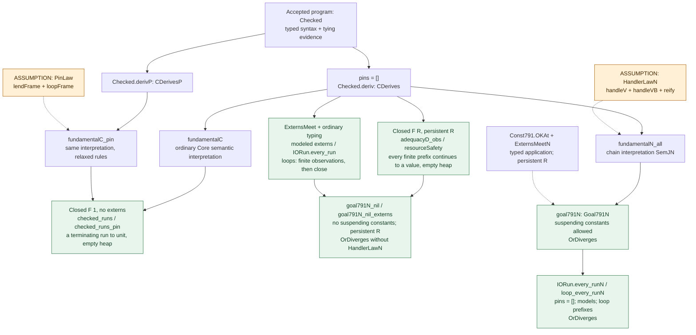
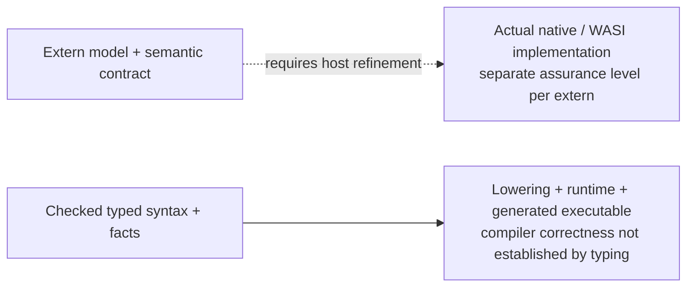

# Kernel assurance map

This is the current proof boundary, checked against the exported Lean statements on
2026-11-14. [SPEC.md](../SPEC.md) defines the intended language; this page distinguishes
what the checker constructs, which semantic theorems apply, and what remains conditional.
It is an interface map, not a complete Lean import graph.

For a particular program, start with `bcc check` / `bcc trusted`: empty pins select the
ordinary path; reported R1 sites select the conditional pinned path. Then check the
result type, extern models and loop premises in the table below.

## Visual proof map

Solid arrows show proof construction or theorem application, subject to the conditions in
the nodes and the table below. Dashed arrows supply additional hypotheses. Alternative
paths are shown separately: there is no conversion from `PinLaw` to `HandlerLawN` here.

`OrDiverges` means: every reachable configuration is a value or can step; a reached value
has empty memory; a reached `free` finds its cell. It allows divergence and does not assert
that a diverging run eventually frees all cells. Definition: [Core/StepsN.lean](../Core/StepsN.lean),
`OrDiverges`.

The two boundaries below sit outside the semantic proof paths above. The diagram does
not claim an end-to-end verified compiler or a refinement proof for each actual host.

## Exported guarantees and their premises

All paths are within Lean's logical foundations and the host interface parameters of the
statements (`Host`, `HostIs`). A named `Prop` hypothesis is an outstanding semantic
assumption even when `#print axioms` reports only the standard logical axioms.

| Path | Current theorem and guarantee | Required scope / assumptions |
| --- | --- | --- |
| Checker certificate | `Checked.typedAt`, `derivAt`, `deriv`; `typedP`, `derivP` in [Program.lean](../Frontend/Check/Program.lean) | Empty pins gives `TDerivesAt → CDerivesAt → CDerives`; every `Checked` gives `TDerivesP → CDerivesP`. The expression is the typed term's erasure. |
| Ordinary semantic typing | `checked_sem → fundamentalC`, [Program.lean](../Frontend/Check/Program.lean), [Fundamental.lean](../Core/Fundamental.lean) | `pins = []`. Semantic typing at the checked context/result; this alone is not a closed-program execution theorem. |
| Ordinary closed execution | `checked_runs → adequacyC`, same files | Empty pins, empty extern context, result `F 1`: a run from empty heap to unit and empty heap. |
| Every-run resource safety | `adequacyD`, `adequacyD_obs`, `resourceSafety`, [Demonic.lean](../Core/Demonic.lean), [EffPrograms.lean](../Core/EffPrograms.lean), [ResourceSafety.lean](../Core/ResourceSafety.lean) | Closed ordinary derivation at `F 1`, or `F R` with persistent `R` for the generalized results. Every reachable prefix continues to a value at empty memory; evaluated frees find live cells. |
| Totality | `total_every_run`, `total_no_infinite_run`, [Totality.lean](../Core/Totality.lean) | Closed ordinary `F A` derivation, with each theorem's stated premises. Do not extend this claim to an unbounded loop merely because it is well typed. |
| Relaxed borrowing | `checked_sem_pin`, `checked_runs_pin`, [Program.lean](../Frontend/Check/Program.lean); `fundamentalC_pin`, [PinFundamental.lean](../Core/PinFundamental.lean) | Assumes `PinLaw`. Closed execution additionally needs empty context and `F 1`. The ordinary empty-pin theorem cannot be applied by ignoring recorded pins. |
| Modeled I/O | `IORun.every_run`, `IORun.loop_every_run`, [Externs.lean](../Frontend/Check/Externs.lean) | Empty pins and standard model values. Non-looping wrapper: every prefix continues to a typed result at empty heap. Looping wrapper: the stated finite observation prefix, then close. Core's more general extern contract is `ExternsMeet` in [Stdio.lean](../Core/Stdio.lean). |
| Runtime divergence | `rtSafety`, [ResourceSafety.lean](../Core/ResourceSafety.lean) | Ordinary computation at `[tickSig]` under `DivRuntime.rtH`: progress and valid frees. This statement does **not** promise leak freedom or termination. |
| Chain safety with suspending lends | `goal791N : HandlerLawN → Goal791N`, [Adequacy791N.lean](../Core/Chain/Adequacy791N.lean) | `Const791.OKAt`, `ExternsMeetN`, ordinary typing in the constants/extern context, persistent answer. After substituting those constants and externs, concludes `OrDiverges`. |
| Same safety shape without suspending constants | `goal791N_nil`, `goal791N_nil_externs`, [GoalNil791N.lean](../Core/Chain/GoalNil791N.lean) | Ordinary closed typing, persistent answer; extern variant requires Core's `ExternsMeet`. These are Core corollaries and need no `HandlerLawN`. They do not cover arbitrary pinned programs. |
| Chain interpretation of checked I/O | `IORun.every_runN`, `IORun.loop_every_runN`, [Externs.lean](../Frontend/Check/Externs.lean) | `HandlerLawN` **and** empty pins, standard model values, the wrapper's loop condition; loop version is per finite observation prefix. This is not a bridge from the pinned judgment to chain safety. |

## Named assumptions

**`PinLaw` — SPEC §29.** [Core/PinLaw.lean](../Core/PinLaw.lean) has two fields:
`lendFrame` for the relaxed lend, and `loopFrame` for the per-observation shared lend
whose loop state may retain views. These are compatibility schemas over typed premises
and semantic premises. `pinLaw_iff` in [PinFundamental.lean](../Core/PinFundamental.lean)
relates them to `PinStop ∧ PinLoop`. They are assumed, not discharged by that equivalence.
The checker records use sites; `bcc check` and `bcc trusted` report the typing assurance.
SPEC §29 currently keeps R1/`PinLaw` unchanged pending A1 and leaves R2 unemitted;
describing the two-field law does not imply that both rules are emitted today.

**`HandlerLawN` — SPEC §62.** [Core/Chain/HandlerLawN.lean](../Core/Chain/HandlerLawN.lean)
has three fields, supplying chain compatibility for `effHandleV`, `effHandleVB`, and
`reify`. `handlerLawN_iff` identifies these with `MissingN`; `fundamentalN_all` then covers
every `CDerives` constructor. It does not prove the three fields. The current obstruction
is the continuation reading at `KW.Owed` versus `KW.OwedR`; [#838](https://github.com/empath-nirvana/borrow-core/issues/838)
and the [boundary analysis](new-core/assert-boundary.md) describe the remaining proof work.

These assumptions are separate. An ordinary program can have Core guarantees without
either one; a pinned checked program needs `PinLaw` for its existing semantic path;
the suspending-constant chain path uses `HandlerLawN`. Neither establishes correctness of
native/WASI implementations or compiler transformations.

## Intended features versus current coverage

| Intended feature / boundary | Current coverage | Remaining work / owner |
| --- | --- | --- |
| Borrows across suspension, SPEC §62 | Kernel chain theorem over `Const791`, conditional on `HandlerLawN`; accepted relaxed surface programs use the separate pinned path | Checker does not emit `Const791` yet: [#843](https://github.com/empath-nirvana/borrow-core/issues/843). Discharge/shrink chain handler assumption: [#838](https://github.com/empath-nirvana/borrow-core/issues/838). |
| Loans shared with spawned tasks | Tier 1 outer borrowed payload support exists, subject to `Row.AnsC`; the callback's own loan escaping its lend (Tier 2) is not covered by that result | Ownership/return obligations: [#821](https://github.com/empath-nirvana/borrow-core/issues/821); borrowed payload distinction: [#844](https://github.com/empath-nirvana/borrow-core/issues/844). |
| Host externs under chain adequacy, SPEC §72 | Model contracts and checked empty-pin wrappers; kernel I/O example with resume/cancel | K1.1–K1.4 and the checked-wrapper theorems exist. K1.5 integration is partial: the corpus headline and `bcc trusted` integration remain outstanding; see [Entry 71 status](status/71.md). Actual hosts retain their own assurance levels. |
| Effectful cancel cleanup / platform suspension | K1 finalisers are effect-free `F 1`; platform-answered suspending I/O is outside K1 | SPEC §72: later K-b/A4, and a world-step run relation/adequacy for platform suspension. |
| Host-resource cleanup | Kernel statements account for cells; effect APIs implement host close protocols | Empty modeled memory is not by itself proof that an OS resource was closed. See SPEC §62 and [decision 73](decisions.md). |
| Compiled execution | Backends consume checked facts; corpus execution and count checks validate implementations | These kernel theorems are not a compiler simulation proof. `UNPROVED:` annotations identify local unproved obligations; [compiler architecture](compiler.md) describes the fact boundary. |

The tree resource carrier and the chain execution relation are different layers. Historical
tree/capture proof routes in [structure.md](new-core/structure.md) are not the checker-to-Core
path above. The operational pivot is recorded in [PR #820](https://github.com/empath-nirvana/borrow-core/pull/820);
shared definitions still used by the chain must be preserved when historical routes are isolated.
The existing total relation remains necessary for termination claims.

## Keeping this map current

Update this page in the same change that alters an exported theorem's hypotheses, checker
pin policy, suspending-constant emission, or an extern/host assurance boundary. Check the
Lean statement, not just an issue title or an axiom inventory. Update the affected SPEC
entry's status paragraph as well. Preserve distinctions between a proved implication, an
assumed premise, successful execution tests, and the intended contract.
